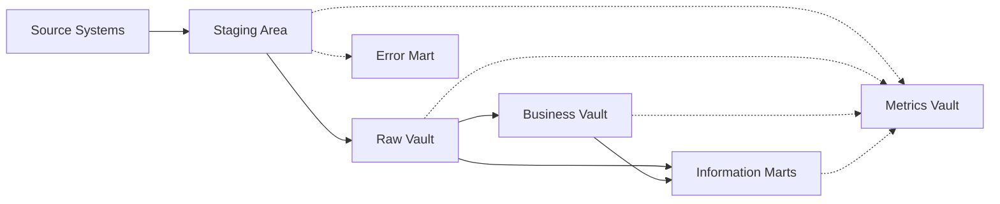

# Data Vault

A practical, end-to-end reference to Data Vault modelling (2.0 era): concepts, structures, architecture, loading, querying, governance and pitfalls.

## Contents

1. [What Data Vault Is](#1-what-data-vault-is)
2. [When to Use It (and When Not To)](#2-when-to-use-it-and-when-not-to)
3. [Core Building Blocks](#3-core-building-blocks)
4. [Keys and Hashing](#4-keys-and-hashing)
5. [Architecture](#5-architecture)
6. [Advanced and Specialised Structures](#6-advanced-and-specialised-structures)
7. [Modelling Process](#7-modelling-process)
8. [Loading Patterns](#8-loading-patterns)
9. [Querying the Vault](#9-querying-the-vault)
10. [Performance and Physical Design](#10-performance-and-physical-design)
11. [Methodology and Delivery](#11-methodology-and-delivery)
12. [Data Vault vs Other Approaches](#12-data-vault-vs-other-approaches)
13. [Governance, Security and Compliance](#13-governance-security-and-compliance)
14. [Common Pitfalls and Anti-Patterns](#14-common-pitfalls-and-anti-patterns)
15. [Worked Example: Retail Orders](#15-worked-example-retail-orders)
16. [Implementation Checklist](#16-implementation-checklist)
17. [Glossary](#17-glossary)
18. [Learning Path and Further Reading](#18-learning-path-and-further-reading)

## 1. What Data Vault Is

Data Vault (DV) is a data modelling methodology and architecture for enterprise data warehouses, created by Dan Linstedt in the 1990s and formalised publicly in 2000. It is designed around three goals:

- **Auditability**: every fact is traceable to its source system and load time.
- **Agility**: new sources and attributes can be added without re-engineering existing structures.
- **Scalability**: loads are highly parallel, with few dependencies between tables.

Data Vault separates **business keys** (identity), **relationships** (associations) and **descriptive context** (attributes over time) into three table types: **Hubs, Links and Satellites**. The raw layer stores data *as delivered by the source*, without applying business rules, so the warehouse becomes a durable, auditable system of record. Business interpretation is applied downstream.

### Data Vault 1.0, 2.0 and 2.1

- **DV 1.0** (2000): the modelling pattern, with sequence-number surrogate keys.
- **DV 2.0** (c. 2013): adds hash keys (or hash-based identity), the full methodology (agile delivery, CMMI-style process), the architecture (staging, raw vault, business vault, marts), NoSQL/big-data compatibility and parallel loading.
- **DV 2.1**: an informal label for later refinements and tooling-driven updates; its scope is not consistently defined across vendors and community material, so check what a given source means by it.

The term 'Data Vault 2.0' covers four pillars: **Methodology**, **Architecture**, **Model** and **Implementation**.

## 2. When to Use It (and When Not To)

**Good fit:**

- Many source systems, frequently changing or being onboarded.
- Strong audit, lineage or regulatory requirements (finance, insurance, healthcare, public sector).
- Large teams that need to work in parallel on the same warehouse.
- Need to preserve history and re-interpret it later as business rules change.
- Desire for automation: DV patterns are highly repetitive and generator-friendly.

**Poor fit:**

- Small, single-source analytics where a star schema is enough.
- Teams without the tooling or discipline to automate; hand-writing hundreds of hubs, links and satellites is costly.
- Cases where end users must query the raw layer directly. DV is not designed to be queried by analysts; marts serve that purpose.

**Trade-off in one line:** DV pays an up-front cost in table count and join complexity to buy flexibility, history and auditability later.

## 3. Core Building Blocks

### 3.1 Hub

A Hub stores the **unique list of business keys** for one core business concept (Customer, Product, Policy, Account).

| Column | Purpose |
| --- | --- |
| Hub hash key (e.g. HK\_CUSTOMER) | Primary key; hash of the business key(s) |
| Business key | The natural identifier from the source (e.g. customer number) |
| Load date (LDTS) | Timestamp when the key first arrived in the warehouse |
| Record source (RSRC) | System the key was first seen in |

Rules:

- Contains **only** keys: no descriptive attributes, no foreign keys to other hubs.
- A business key is inserted **once**; hubs are insert-only.
- A good business key is meaningful to the business, stable, and used across systems. Avoid source surrogate IDs when a real business key exists.
- Composite business keys are allowed (e.g. company code + account number).
- The same key from different systems may collide semantically; use a **business key collision code** (BKCC) or tenant ID to disambiguate.

### 3.2 Link

A Link records a **relationship or transaction between two or more hubs**.

| Column | Purpose |
| --- | --- |
| Link hash key | Hash of all participating business keys (and optionally a collision code) |
| Hub hash keys | One foreign key per related hub |
| Load date | When the relationship was first seen |
| Record source | Where it came from |

Rules:

- Links are **many-to-many by design**, which absorbs cardinality changes without remodelling.
- Granularity matters. The link grain is defined by the combination of keys it holds; decide it deliberately.
- Links hold no descriptive attributes (those go in link satellites), with the exception of non-historized links, which carry their own attributes (see 6.8), and degenerate keys such as a line number.
- Links can relate a hub to itself (e.g. employee to manager), called a **recursive** or **hierarchical** link.
- Keep link grain tight. Avoid 'mega-links' that join many hubs without need, as they become rigid and hard to load.

### 3.3 Satellite

A Satellite stores **descriptive context and its history** for exactly one parent (a hub or a link).

| Column | Purpose |
| --- | --- |
| Parent hash key | Reference to the hub or link |
| Load date | Start of this version (part of the primary key) |
| Record source | Origin of the data |
| Hash diff | Hash of all descriptive columns, used for change detection |
| Descriptive attributes | Name, address, price, status, etc. |
| (optional) Load end date | Derived/virtual; usually computed with LEAD() rather than stored |

Rules:

- Insert-only. A new row is inserted when the **hash diff** differs from the latest row for that key.
- Rows are never updated to close them. End dates are derived at query time (LEAD over load date) or exposed through a view, which keeps loads strictly insert-only.
- Split satellites by **source system**, **rate of change**, **data classification** (PII vs not), and **subject area**. This keeps churn low and enables fine-grained security.
- One satellite has exactly one parent.
- Do not store business logic here in the raw vault.

## 4. Keys and Hashing

DV 2.0 replaced sequence surrogate keys with **hash keys** because:

- Hubs, links and satellites can load **in parallel**, with no lookup of a sequence from a hub first.
- Keys can be computed anywhere (source, stream, lake, warehouse), and are deterministic and repeatable.
- Works across heterogeneous platforms (relational, Hadoop, cloud object stores).

**Hash key construction (typical):**

1. Take the business key(s).
2. Standardise: trim, upper-case, handle NULL (commonly replaced with an empty string, keeping delimiters in place so each position stays distinct), apply consistent data type formatting.
3. Concatenate with a delimiter (e.g. '||') to prevent ambiguity ('AB'+'C' vs 'A'+'BC').
4. Hash with MD5, SHA-1 or SHA-256; store as CHAR(32)/BINARY(16) etc.

**Link hash keys** follow the same pattern over the business keys of every participating hub, concatenated in a fixed, documented order, so the same relationship always yields the same hash.

**Hash diff** follows the same pattern over the descriptive columns of a satellite, in a fixed order, enabling a single-column comparison to detect change. It covers descriptive attributes only: not the parent key, load date or record source. Normalise values the same way as for keys (numeric scale, date/timestamp format, boolean representation); otherwise cosmetic differences such as `1.0` vs `1.00` create spurious new versions. *SQL example: 15.2.*

**Considerations:**

- **Collisions**: for non-adversarial data the probability is negligible with SHA-256 at warehouse volumes, and very low with MD5, which is common for speed and size (its known weakness is against deliberately crafted collisions, which rarely matters for identifiers). Choose per risk appetite and platform, and settle the algorithm up front: changing it later means rehashing every table.
- **Case and whitespace rules must be identical** everywhere hashes are computed, or the same key will produce different hashes.
- **Stored vs hashed values**: standardisation (trim, upper-case) is applied to the hash input; the business key itself is typically stored as delivered.
- **Missing keys**: never load NULL or empty business keys into a hub. When a link's hub reference is missing in the source, point it at the hub's ghost (zero) record so the row stays loadable and joinable.
- Some platforms (e.g. MPP engines) allow using the business key directly as the join key; hashing is a strong recommendation rather than a hard requirement, and some teams use the business key directly where hashing adds no value.
- Hash keys are **not** for security; they are identifiers.

## 5. Architecture



### 5.1 Staging

- Landing area for source data, loaded as-is with minimal change.
- Adds technical columns: load date, record source, (optionally) hash keys and hash diffs, batch IDs, sequence/ordering for CDC.
- Typically **transient** (truncate and reload) or a persistent staging / data lake zone when replay is required.
- No business rules, no cleansing that alters meaning.
- Hard rules only: data type alignment, character set, and the like.

### 5.2 Raw Vault

- The integrated, historised, **unmodified** store of source data in hub/link/satellite form.
- Integration happens **by business key**, not by transforming values.
- It is the single version of the facts: 'what the source said, when we received it'.
- Must be **fully reproducible** (loads are deterministic and idempotent), and every downstream layer can be rebuilt from it.

### 5.3 Business Vault

- Optional layer that stores **derived, business-rule-applied** data, still in vault structures.
- Used to **share computed results** across marts (e.g. harmonised customer status, currency-converted amounts, deduplication results, calculated KPIs).
- Contains business satellites, business links, PIT and bridge tables, and reference-style computed tables.
- It is **sparsely built**: only for rules that are reused or expensive to compute. It is not a copy of the raw vault.
- Because it is derived, it can be dropped and rebuilt from the raw vault.

### 5.4 Information Marts (Delivery Layer)

- Consumption-oriented structures: **star schemas, wide flat tables, cubes, semantic models, feature tables, API views**.
- Often built as **views** over the vault (virtualised) when performance allows, materialised when it doesn't.
- This is where business rules specific to a report or domain are applied, and where Kimball techniques fit (see Section 12).

### 5.5 Supporting Marts

- **Metrics Vault**: operational metadata (load durations, row counts, SLAs).
- **Error Mart**: records failing hard-rule or quality checks, kept visible rather than discarded.
- **Quality Mart / Soft-rule results**: outcomes of data quality rules.

### 5.6 Hard Rules vs Soft Rules

- **Hard rules** run before the raw vault and never change the meaning of the data: data type alignment, trimming, character set handling, splitting multi-structure files, adding technical columns and computing hashes.
- **Soft rules** apply business interpretation: calculations, cleansing, standardisation, harmonisation of codes, deduplication and conformance. They run after the raw vault (business vault or marts), so they can change without reloading history.

### 5.7 Mapping to a Lakehouse (Medallion) Architecture

| Medallion layer | Typical Data Vault counterpart |
| --- | --- |
| Bronze | Staging / landing zone |
| Silver | Raw vault, plus business vault where rules are shared |
| Gold | Information marts (stars, wide tables, feature tables) |

The mapping is loose. The vault adds key-based integration, explicit relationships and full audit history, which the medallion pattern alone does not prescribe.

## 6. Advanced and Specialised Structures

### 6.1 Reference Tables

Store code lists and lookup data (country codes, status descriptions) without full hub/link/satellite treatment. Keep history when needed via a base table plus history table, or a reference hub/satellite pair.

### 6.2 Point-in-Time (PIT) Tables

A PIT table precomputes, per hub key and snapshot date, **which satellite row was current** for each satellite. It turns an expensive multi-satellite temporal join into simple equi-joins.

- Columns: hub hash key, snapshot date, and for each satellite the (hash key, load date) of the active row.
- Built for a snapshot cadence (daily, monthly); often with a logarithmic retention (keep daily recently, monthly further back).
- Use **ghost records** (a default dummy row in each satellite) so the PIT never has NULL pointers and joins stay inner joins. *Build example: 15.8.*

### 6.3 Bridge Tables

A bridge precomputes **link-based joins** across several hubs and links (a walk through the graph), optionally including computed measures. It is the link-side equivalent of PIT and helps with performance and grain control.

### 6.4 Multi-Active Satellites

When a parent legitimately has **several simultaneously valid rows** (e.g. a customer with multiple phone numbers), the satellite adds a sub-sequence or a discriminating key to the primary key. Change detection is done on the whole set per parent. *Worked example: 15.4.*

### 6.5 Effectivity Satellites

Track the **validity period of a relationship** (link) or hub key: when it started, ended or was deleted, based on source-delivered dates or inferred from the presence or absence of records.

On a link, an effectivity satellite needs a **driving key**: the hub key (or keys) that 'drives' the relationship. When the driving key appears with a new partner, the previous relationship for that key is end-dated. Example: an employee (driving key) moves to a new department, so the old employee-department link is closed and the new one opened. *Worked example: 15.5.*

### 6.6 Status Tracking Satellites

Record the **insert/update/delete status** of a key or relationship per load, useful when the source provides only full snapshots without delete flags. *Example: 15.7.*

### 6.7 Record Tracking Satellites

Log **when a key was seen** in each delivery (an appearance log). Helps detect disappearance and support audit questions such as 'was this key in the file on that day?'.

### 6.8 Non-Historized Links (Transactional Links)

For **immutable events** (clicks, sensor readings, payment transactions), keep the descriptive attributes in the link itself instead of a separate satellite, as no history of change is needed. Saves a join and storage. If the source can correct or reverse a transaction, either record the correction as a new transaction row (a counter-booking) or use a standard link with a satellite instead. *Example: 15.6.*

### 6.9 Same-As Links (SAL)

Map multiple business keys that represent the **same real-world entity** (master data matching, deduplication). The raw vault keeps all keys; the SAL, usually in the business vault, records the survivor/duplicate mapping.

### 6.10 Hierarchical Links

Represent parent-child structures within a single hub (org charts, product categories, bills of material).

### 6.11 Computed (Business) Satellites

Satellites populated by business rules rather than loaded directly from a source. Their record source is typically a rule name or process identifier.

### 6.12 Ghost / Zero Records

Default rows (e.g. key 0000...0, dates in the far past) added to hubs and satellites so downstream joins can be inner joins and handle missing members predictably. *Example: 15.9.*

### 6.13 Dependent-Child Keys

A **dependent-child key** is a degenerate attribute (such as an order line number or a sequence) that only has meaning together with its parent key. It is stored as part of the satellite or link key (not as a hub), so the grain is unambiguous without creating a hub for a concept the business does not manage on its own.

### 6.14 Applied Date vs Load Date (Bitemporality)

The **load date** records when the warehouse learned something; the **applied date** (or business effective date) records when it was true in the business. Keep both. Load date drives auditability and ordering. Applied dates are stored as attributes and used for business-time queries, so you can answer 'what did we believe on day X about the state on day Y'.

### 6.15 Handling Business Key Changes

Never update a hub key. If a source re-keys an entity, load the new key as a new hub row and relate old and new keys with a same-as link or a key-mapping structure in the business vault. History stays intact, and downstream layers can resolve both keys to one entity.

### 6.16 Structure Cheat Sheet

| Structure | Attached to | Key | Holds | Use when |
| --- | --- | --- | --- | --- |
| Hub | none | Hub hash key | Business key, load date, record source | One row per business entity |
| Link | 2+ hubs (1 if recursive) | Link hash key | Hub hash keys | Relationships and transactions |
| Satellite | Hub or link | Parent hash key + load date | Attributes, hash diff | Descriptive history |
| Multi-active satellite | Hub or link | Parent hash key + load date + discriminator | Several simultaneously valid rows | Phones, addresses, price tiers |
| Effectivity satellite | Link (or hub) | Parent hash key + load date | Start, end, deleted flag | Validity of a relationship |
| Status tracking satellite | Hub or link | Parent hash key + load date | I/U/D status per load | Full-snapshot feeds without delete flags |
| Record tracking satellite | Hub or link | Parent hash key + load date | Appearance log | Audit of what appeared in each delivery |
| Non-historized link | 2+ hubs | Link hash key | Keys and immutable attributes | Events, transactions, sensor data |
| Same-as link | One hub, twice | Link hash key | Master and duplicate hash keys | Deduplication, re-keyed entities |
| PIT table | Hub (or link) | Parent hash key + snapshot date | Satellite row pointers | As-of joins across satellites |
| Bridge table | Links and hubs | Defined by the walk | Pre-joined keys, optional measures | Faster link traversal, grain control |
| Reference table | none | Code | Code lists, lookups | Static or slowly changing codes |

## 7. Modelling Process

1. **Understand the business**: capture core concepts, processes and terminology with business stakeholders. Build or reuse a conceptual / ontology model.
2. **Identify business keys**: for each concept, determine keys used across systems. Test uniqueness, stability and cross-system availability.
3. **Define hubs** from those concepts and keys.
4. **Define links** from the relationships and transactions between concepts. Decide the grain explicitly.
5. **Attach satellites** to hubs and links; split by source, change rate, sensitivity and subject.
6. **Add special structures** as needed: multi-active, effectivity, non-historized links, reference data.
7. **Document** keys, grain, and mapping from source columns to targets.
8. **Review** with source experts and business owners; iterate.

**Tips**

- Model from the **business view**, not by mirroring the source schema table by table.
- If a source table has several business concepts, it feeds several hubs.
- If the same concept comes from several systems, they feed the **same hub**, with different satellites per source.
- Prefer a smaller number of well-chosen hubs over many ambiguous ones.
- Resist 'normalising' the vault beyond the three-structure rule.

## 8. Loading Patterns

All loads are **insert-only** and **idempotent** (re-running a load does not create duplicates).

### 8.1 Hub Load

```sql
INSERT INTO hub_customer (hk_customer, customer_bk, load_dts, rec_src)
SELECT hk_customer, customer_bk, load_dts, rec_src
FROM (
  SELECT s.hk_customer, s.customer_bk, s.load_dts, s.rec_src,
         ROW_NUMBER() OVER (PARTITION BY s.hk_customer ORDER BY s.load_dts) AS rn
  FROM stg_crm_customer s
) st
WHERE st.rn = 1
  AND NOT EXISTS (
    SELECT 1 FROM hub_customer h WHERE h.hk_customer = st.hk_customer
  );
```

### 8.2 Link Load

```sql
INSERT INTO lnk_order_customer (hk_lnk, hk_order, hk_customer, load_dts, rec_src)
SELECT hk_lnk, hk_order, hk_customer, load_dts, rec_src
FROM (
  SELECT s.hk_lnk, s.hk_order, s.hk_customer, s.load_dts, s.rec_src,
         ROW_NUMBER() OVER (PARTITION BY s.hk_lnk ORDER BY s.load_dts) AS rn
  FROM stg_sales_order s
) st
WHERE st.rn = 1
  AND NOT EXISTS (
    SELECT 1 FROM lnk_order_customer l WHERE l.hk_lnk = st.hk_lnk
  );
```

### 8.3 Satellite Load (delta on hash diff)

```sql
INSERT INTO sat_customer_crm (hk_customer, load_dts, hash_diff, name, email, rec_src)
SELECT st.hk_customer, st.load_dts, st.hash_diff, st.name, st.email, st.rec_src
FROM (
  SELECT s.*,
         LAG(s.hash_diff) OVER (PARTITION BY s.hk_customer ORDER BY s.load_dts) AS prev_hash_diff
  FROM stg_crm_customer s
) st
LEFT JOIN (
  SELECT hk_customer, hash_diff,
         ROW_NUMBER() OVER (PARTITION BY hk_customer ORDER BY load_dts DESC) AS rn
  FROM sat_customer_crm
) cur ON cur.hk_customer = st.hk_customer AND cur.rn = 1
WHERE (
        (st.prev_hash_diff IS NULL
         AND (cur.hk_customer IS NULL OR cur.hash_diff <> st.hash_diff))
     OR (st.prev_hash_diff IS NOT NULL
         AND st.prev_hash_diff <> st.hash_diff)
      )
  AND NOT EXISTS (  -- makes a re-run of the same batch a no-op
    SELECT 1 FROM sat_customer_crm t
    WHERE t.hk_customer = st.hk_customer AND t.load_dts = st.load_dts
  );
```

**Batches with several versions of a key:** the hub and link loads keep only the earliest row per key in the batch. The satellite load uses LAG so that, when one staged batch holds several versions of the same key, only real changes are inserted: the first version is compared with the current satellite row, later ones with the previous version in the batch. The final `NOT EXISTS` guard keeps the load idempotent: without it, re-running a batch that holds several versions of a key would compare the first version with the already-loaded latest row and try to insert it again.

### 8.4 Key Principles

- **Hubs, links and satellites load independently and in parallel**, because hash keys are computed in staging.
- **Load date** is the time the warehouse received the data, never the business effective date. Business dates are stored as attributes.
- **Record source** should identify system and, ideally, the table or feed.
- **Deletes** are not physically applied: model them via status/effectivity satellites or end-dating.
- **Late-arriving and out-of-order data**: use ordering by load date and stage-level sequencing; satellite loads should compare against the correct predecessor.
- **Full vs delta feeds**: delta feeds rely on CDC flags; full snapshots rely on hash diff comparison and status tracking to detect deletes.
- **Streaming and micro-batch**: patterns are identical, with smaller batches; ensure deduplication within a batch.
- **Concurrent loads into the same hub or link**: when several sources feed one hub in parallel, two jobs can insert the same new key at the same moment. Serialise those loads, use one insert-if-not-exists (MERGE) step per target, or deduplicate afterwards. Most cloud warehouses treat primary and unique keys as informational only, so uniqueness must be protected by the load pattern and verified by tests (8.6).
- **Referential integrity**: foreign keys are normally not enforced, which is what allows order-independent parallel loads. Detect orphans with tests instead.
- **Satellite schema evolution**: adding a column to a satellite changes the hash diff formula, so the next load would see every row as changed. Either put new attributes in a new satellite (the more agile option), or add the column and plan the transition deliberately (accept a one-off wave of new versions, or backfill and rehash). Never change the hash diff formula silently.

### 8.5 Naming Conventions and Standard Columns

| Object | Convention (example) |
| --- | --- |
| Hub | hub\_ prefix plus the concept: hub\_customer |
| Link | lnk\_ prefix plus the hubs involved: lnk\_order\_customer |
| Satellite | sat\_ prefix plus parent and source: sat\_customer\_crm |
| PIT / bridge | pit\_customer, brg\_order\_product |
| Same-as link | sal\_customer |
| Hash key | hk\_ prefix plus the table or concept: hk\_customer |
| Standard columns | load\_dts, rec\_src, hash\_diff, and optionally batch\_id |

Agree the convention once, document it, and let the generator enforce it.

### 8.6 Testing and Data Quality

- **Hubs:** business key and hash key are unique; no NULL or empty keys.
- **Links:** link hash key is unique; every referenced hub hash exists in its hub (no orphans).
- **Satellites:** (hash key, load date) is unique; no two consecutive rows share a hash diff; every parent key exists.
- **Reconciliation:** row counts and checksums match between staging and raw vault, and between raw vault and marts.
- **Hash consistency:** recompute a sample of hashes independently and compare.
- **Idempotency:** re-running a load changes nothing.
- **Freshness and SLAs:** record load durations and latest load dates in the metrics vault.
- **Ghost records:** present in every hub and satellite that joins rely on.

Runnable query examples for these checks are in 15.10.

## 9. Querying the Vault

The vault is optimised for **loading and storage**, not ad-hoc querying. Typical access paths:

- **Current-state view**: for each satellite, a view returning only the latest row per key (using ROW\_NUMBER or LEAD to derive end dates).
- **As-of query**: join hub to satellites using PIT tables, or filter satellites on `load_dts <= :asof` and latest per key.
- **Dimensional views**: dimension = hub + satellites (via PIT); fact = link (or non-historized link) + measures + keys to dimension hubs.

```sql
-- Current customer dimension
SELECT h.customer_bk, s.name, s.email
FROM hub_customer h
JOIN sat_customer_crm s ON s.hk_customer = h.hk_customer
WHERE s.load_dts = (
  SELECT MAX(load_dts) FROM sat_customer_crm x WHERE x.hk_customer = s.hk_customer
);
```

With a PIT table the as-of version of a customer becomes a set of equi-joins:

```sql
SELECT h.customer_bk, p.snapshot_dts, s1.name, s2.credit_limit
FROM pit_customer p
JOIN hub_customer h      ON h.hk_customer = p.hk_customer
JOIN sat_customer_crm s1 ON s1.hk_customer = p.crm_hk AND s1.load_dts = p.crm_ldts
JOIN sat_customer_erp s2 ON s2.hk_customer = p.erp_hk AND s2.load_dts = p.erp_ldts
WHERE p.snapshot_dts = DATE '2026-09-30';
```

Best practice: expose business-friendly **views** and let analysts work on marts, not raw hubs and links.

## 10. Performance and Physical Design

- **Equi-joins on hash keys**; avoid range joins by using PIT/bridge.
- **Partition** or order satellites and links by load date, which suits incremental loads and as-of filters. Clustering on a random hash key is platform-dependent and often gives little pruning benefit; measure before adopting it.
- **Column stores and MPP engines** (Snowflake, Synapse, BigQuery, Redshift, Databricks) suit DV well; use each platform's own partition pruning and clustering features.
- Use **fixed-length binary** hashes where supported to save space and speed joins.
- **Virtualise marts first**, materialise only where measured performance demands it.
- **Constraints**: primary and foreign keys are informational on most cloud warehouses, so enforce uniqueness and referential integrity through load patterns and automated tests.
- **Retention**: archive or thin PIT snapshots; apply data lifecycle policies to old satellite versions where regulation allows.
- **Row counts grow with change rate**, not just volume: highly volatile attributes belong in their own satellites.

## 11. Methodology and Delivery

Data Vault 2.0 includes an agile delivery approach:

- **Sprint-based** delivery of vertical slices (a business question end to end: source to mart).
- **Pattern-driven build**: because structures are standardised, teams generate code from metadata.
- **Automation** is central: source-to-target mappings in a metadata repository drive generation of DDL, hash logic and loading SQL (tools such as dbt with AutomateDV (formerly dbtvault) or datavault4dbt, WhereScape, VaultSpeed, Erwin and various custom generators; see 15.12 for a dbt example).
- **Testing** is built in: record counts, key uniqueness in hubs, no orphans (referential checks), hash diff correctness, reconciliation to source, and idempotency checks.
- **Roles**: data architect/modeller, ETL/ELT engineer, business analyst, data steward, QA, platform engineer.
- **Maturity**: DV 2.0 methodology draws on CMMI, Six Sigma, TQM and agile/Scrum practice, with a focus on repeatable, measurable, optimised processes.

## 12. Data Vault vs Other Approaches

| Aspect | Data Vault | Kimball (Dimensional) | Inmon (3NF EDW) |
| --- | --- | --- | --- |
| Primary goal | Auditable integration layer | Fast, understandable analytics | Normalised enterprise truth |
| Structure | Hubs, links, satellites | Facts and dimensions | Normalised entities |
| Change tolerance | Very high | Moderate (SCD handling) | Moderate |
| History | Native, insert-only | Via SCD types | Via history tables |
| Business rules | Pushed downstream | Applied during ETL | Applied during ETL |
| Query friendliness | Low (needs marts) | High | Medium |
| Load parallelism | Very high | Moderate | Moderate |
| Best layer | Integration/raw | Presentation | Integration |

**They are complementary.** A common pattern is **Data Vault for the integration layer and Kimball star schemas for the presentation layer**. DV handles ingestion, history and lineage; star schemas serve BI.

## 13. Governance, Security and Compliance

- **Lineage**: record source and load date on every row; metadata catalogue maps each column back to the source.
- **PII isolation**: split sensitive attributes into dedicated satellites so access control, masking, encryption or deletion (e.g. GDPR right to erasure) can target them without touching the rest of the vault.
- **Right to be forgotten**: although the vault is insert-only, regulated erasure is implemented by deleting or anonymising the relevant satellite rows (and sometimes the hub key mapping), documented as a controlled exception. *Example: 15.11.*
- **Hashing is not anonymisation**: if a business key is itself personal (an email address, a national ID), the hub stores it in clear and its hash remains linkable and can be reversed by brute force for low-entropy values. Prefer non-personal business keys, or treat the hub, links and every satellite carrying that key as in scope for erasure. Crypto-shredding (encrypting PII with per-subject keys and destroying the key) is an alternative to deleting rows.
- **Audit**: because raw data is never altered, the vault answers 'what did we know and when'.
- **Data quality**: soft rules live downstream; the vault stores data as received and the error mart exposes issues.
- **Ownership**: assign stewards per hub (business concept) and per source (feed).

## 14. Common Pitfalls and Anti-Patterns

1. **Treating DV as a reporting layer**: exposing raw hubs/links/satellites directly to analysts.
2. **Source-mirroring**: one hub per source table instead of per business concept.
3. **Bad business keys**: using volatile surrogate IDs, or keys that are not shared across systems, defeating integration.
4. **Business rules in the raw vault**: cleansing or transforming data before storing it breaks auditability.
5. **Over-sized satellites**: mixing fast and slow-changing attributes causes row explosion.
6. **Mega-links**: too many hubs in one link make grain unclear and loads brittle.
7. **Satellites with multiple parents** or hubs with descriptive columns.
8. **Inconsistent hashing rules** across pipelines, causing orphaned or duplicated keys.
9. **Skipping automation**: hand-coding becomes unmaintainable and error-prone.
10. **Building everything in the business vault**: it should be selective, driven by reuse.
11. **Ignoring deletes**: leaving relationships 'alive' forever when the source has ended them.
12. **No PIT/bridge strategy**: leading to slow, deeply nested temporal joins.
13. **Using business effective dates as load dates**: breaks reproducibility and ordering.

## 15. Worked Example: Retail Orders

This section builds one small model end to end. SQL is Snowflake-flavoured (`MD5_BINARY`, `TIMESTAMP_NTZ`); adapt function names to your platform. `:batch_ts` stands for the single load timestamp the orchestrator assigns to a batch.

### 15.1 Model

**Business concepts:** Customer, Product, Order. **Relationships:** Order placed by Customer; Order contains Product (line item).

**Hubs**

- `hub_customer` (hk\_customer, customer\_number, load\_dts, rec\_src)
- `hub_product` (hk\_product, sku, load\_dts, rec\_src)
- `hub_order` (hk\_order, order\_number, load\_dts, rec\_src)

**Links**

- `lnk_order_customer` (hk\_lnk, hk\_order, hk\_customer, ...)
- `lnk_order_line` (hk\_lnk, hk\_order, hk\_product, line\_number as degenerate key, ...)

**Satellites**

- `sat_customer_crm` (name, email, segment), `sat_customer_pii` (date of birth, phone) split for security.
- `sat_customer_web` for attributes from the web platform.
- `sat_product_erp` (description, category, list price).
- `sat_order_erp` (order date, status, channel).
- `sat_order_line_erp` on the line link (quantity, unit price, discount).
- `sat_order_line_eff` effectivity satellite on `lnk_order_line` (driving key: order): closes a line when it disappears from the order and reopens it if it returns. Order status such as cancelled is a normal attribute in `sat_order_erp`, not an effectivity concern.

**Business Vault**

- `sat_customer_lifetime_value_bv` (computed), `sal_customer` (same-as link merging duplicate customers from CRM and web).
- `pit_customer` (daily snapshot of current rows across customer satellites).

**Mart**

- `dim_customer` from hub + PIT + satellites; `dim_product`; `fact_order_line` from the order-line link with measures and keys to dimensions.

### 15.2 Tables and Staging with Hashes

```sql
CREATE TABLE hub_customer (
  hk_customer  BINARY(16)    NOT NULL,   -- MD5 of the standardised business key
  customer_bk  VARCHAR(50)   NOT NULL,
  load_dts     TIMESTAMP_NTZ NOT NULL,
  rec_src      VARCHAR(100)  NOT NULL,
  PRIMARY KEY (hk_customer)
);

CREATE TABLE lnk_order_customer (
  hk_lnk       BINARY(16)    NOT NULL,   -- MD5 of order key || customer key
  hk_order     BINARY(16)    NOT NULL,
  hk_customer  BINARY(16)    NOT NULL,
  load_dts     TIMESTAMP_NTZ NOT NULL,
  rec_src      VARCHAR(100)  NOT NULL,
  PRIMARY KEY (hk_lnk)
);

CREATE TABLE sat_customer_crm (
  hk_customer  BINARY(16)    NOT NULL,
  load_dts     TIMESTAMP_NTZ NOT NULL,
  hash_diff    BINARY(16)    NOT NULL,
  rec_src      VARCHAR(100)  NOT NULL,
  name         VARCHAR(200),
  email        VARCHAR(320),
  segment      VARCHAR(50),
  PRIMARY KEY (hk_customer, load_dts)
);
```

Primary keys are informational on most cloud warehouses; uniqueness is protected by the load pattern and the tests in 15.10.

All hashing happens once, in staging, with the same expressions every time:

```sql
-- stg_crm_customer (in practice a table or a dbt model)
SELECT
  MD5_BINARY(UPPER(TRIM(c.customer_number)))              AS hk_customer,
  c.customer_number                                       AS customer_bk,   -- stored as delivered
  MD5_BINARY(CONCAT_WS('||',                              -- descriptive columns only, fixed order
      COALESCE(TRIM(c.name), ''),                         -- COALESCE because CONCAT_WS skips NULLs
      COALESCE(TRIM(c.email), ''),                        -- no case-folding: a case-only change is a change
      COALESCE(TRIM(c.segment), '')))                     AS hash_diff,
  c.name, c.email, c.segment,
  :batch_ts                                               AS load_dts,      -- one value per batch
  'crm.customers'                                         AS rec_src
FROM raw_crm.customers c
WHERE c.customer_number IS NOT NULL;                      -- NULL keys never reach a hub

-- stg_sales_order: the link hash uses the hub keys in a fixed order
SELECT
  MD5_BINARY(UPPER(TRIM(o.order_number)))                 AS hk_order,
  MD5_BINARY(UPPER(TRIM(o.customer_number)))              AS hk_customer,
  MD5_BINARY(CONCAT_WS('||', UPPER(TRIM(o.order_number)),
                             UPPER(TRIM(o.customer_number)))) AS hk_lnk,
  :batch_ts AS load_dts, 'erp.orders' AS rec_src
FROM raw_erp.orders o;
```

### 15.3 Satellite History, Step by Step

The CRM delivers the same customer every night:

| Delivery | customer_number | name | email | segment |
| --- | --- | --- | --- | --- |
| 2026-10-01 | C-1001 | Anna Roy | anna@old.example | Gold |
| 2026-10-02 | C-1001 | Anna Roy | anna@new.example | Gold |
| 2026-10-03 | C-1001 | Anna Roy | anna@new.example | Gold |
| 2026-10-04 | C-1001 | Anna Roy | anna@new.example | Silver |

`hub_customer` gets **one row** (C-1001, load date 2026-10-01). `sat_customer_crm` gets **three rows**; the unchanged delivery on 10-03 is skipped because its hash diff equals the latest row:

| load_dts | hash_diff (illustrative) | email | segment |
| --- | --- | --- | --- |
| 2026-10-01 | h1 | anna@old.example | Gold |
| 2026-10-02 | h2 | anna@new.example | Gold |
| 2026-10-04 | h3 | anna@new.example | Silver |

End dates are never stored; a view derives them:

```sql
CREATE VIEW sat_customer_crm_v AS
SELECT s.*,
       COALESCE(LEAD(s.load_dts) OVER (PARTITION BY s.hk_customer ORDER BY s.load_dts),
                TIMESTAMP '9999-12-31 00:00:00') AS load_end_dts
FROM sat_customer_crm s;

-- What did we hold for C-1001 at noon on 3 October?
SELECT h.customer_bk, s.name, s.email, s.segment
FROM hub_customer h
JOIN sat_customer_crm_v s ON s.hk_customer = h.hk_customer
WHERE h.customer_bk = 'C-1001'
  AND TIMESTAMP '2026-10-03 12:00:00' >= s.load_dts
  AND TIMESTAMP '2026-10-03 12:00:00' <  s.load_end_dts;
-- returns anna@new.example, Gold
```

### 15.4 Multi-Active Satellite: Several Phone Numbers

A customer can hold several phone numbers at once, so the discriminator `phone_type` joins the primary key.

```sql
CREATE TABLE sat_customer_phone_ma (
  hk_customer  BINARY(16)    NOT NULL,
  load_dts     TIMESTAMP_NTZ NOT NULL,
  phone_type   VARCHAR(20)   NOT NULL,   -- discriminator
  hash_diff    BINARY(16)    NOT NULL,   -- hash of this row's descriptive columns
  rec_src      VARCHAR(100)  NOT NULL,
  phone_number VARCHAR(30),
  PRIMARY KEY (hk_customer, load_dts, phone_type)
);
```

Change detection compares the **whole set** per customer (row count plus the hash diffs in `phone_type` order), not individual rows:

| Delivery | Phones delivered | Rows stored |
| --- | --- | --- |
| 2026-10-01 | mobile +1-555-0101, home +1-555-0102 | 2 rows at 10-01 |
| 2026-10-02 | mobile +1-555-0101 (home removed) | 1 row at 10-02 (the new full set) |
| 2026-10-03 | mobile +1-555-0101 | nothing, set unchanged |

```sql
-- Current phones = the full set at the latest load date
SELECT s.*
FROM sat_customer_phone_ma s
WHERE s.load_dts = (SELECT MAX(x.load_dts)
                    FROM sat_customer_phone_ma x
                    WHERE x.hk_customer = s.hk_customer);
```

Edge case: when a customer's last phone disappears, the "new full set" is empty. Record that through a status tracking satellite (15.7) or an explicit empty-set marker row.

### 15.5 Effectivity Satellite and Driving Key

Order O-500 is first assigned to customer C-1001, then moved to C-2002 on 5 October. The order is the **driving key**: it has exactly one customer at a time.

`lnk_order_customer` ends up with two rows (two different link hashes: O-500/C-1001 and O-500/C-2002). The effectivity satellite tracks which one is open:

| hk_lnk | load_dts | start_dts | end_dts |
| --- | --- | --- | --- |
| link O-500/C-1001 | 2026-10-01 | 2026-10-01 | 9999-12-31 |
| link O-500/C-1001 | 2026-10-05 | 2026-10-01 | 2026-10-05 |
| link O-500/C-2002 | 2026-10-05 | 2026-10-05 | 9999-12-31 |

Load rule: when the order arrives with a link hash different from its currently open one, insert a closing row for the old link and an opening row for the new link. Nothing is updated or deleted.

```sql
-- Current customer per order
SELECT o.order_number, c.customer_bk
FROM (
  SELECT e.*, ROW_NUMBER() OVER (PARTITION BY e.hk_lnk ORDER BY e.load_dts DESC) AS rn
  FROM sat_order_customer_eff e
) e
JOIN lnk_order_customer l ON l.hk_lnk = e.hk_lnk
JOIN hub_order o          ON o.hk_order = l.hk_order
JOIN hub_customer c       ON c.hk_customer = l.hk_customer
WHERE e.rn = 1
  AND e.end_dts = TIMESTAMP '9999-12-31 00:00:00';
```

Without the effectivity satellite, both links would look equally current and a join from order to customer would return two rows.

### 15.6 Non-Historized Link: Payments

Payments are immutable events, so their attributes live in the link itself and no satellite or hash diff is needed.

```sql
CREATE TABLE nhl_payment (
  hk_lnk       BINARY(16)    NOT NULL,   -- hash of order key || customer key || payment_id
  hk_order     BINARY(16)    NOT NULL,
  hk_customer  BINARY(16)    NOT NULL,
  payment_id   VARCHAR(50)   NOT NULL,   -- degenerate key
  amount       NUMBER(18,2)  NOT NULL,
  currency     CHAR(3)       NOT NULL,
  paid_ts      TIMESTAMP_NTZ NOT NULL,   -- business time, an attribute, not the load date
  load_dts     TIMESTAMP_NTZ NOT NULL,
  rec_src      VARCHAR(100)  NOT NULL,
  PRIMARY KEY (hk_lnk)
);
```

The load is insert-if-not-exists on `hk_lnk`, as for any link. A refund arrives as its own row with its own `payment_id` and a negative amount; the original row is never touched.

### 15.7 Status Tracking: Detecting Deletes in Full Snapshots

The CRM sends a full customer file every night with no delete flag. A status tracking satellite records when a key appears and disappears:

```sql
-- Keys that are new, or that came back after being marked deleted
INSERT INTO sts_customer_crm (hk_customer, load_dts, status, rec_src)
SELECT DISTINCT s.hk_customer, :batch_ts, 'I', 'crm.customers'
FROM stg_crm_customer s
LEFT JOIN (
  SELECT hk_customer, status,
         ROW_NUMBER() OVER (PARTITION BY hk_customer ORDER BY load_dts DESC) AS rn
  FROM sts_customer_crm
) cur ON cur.hk_customer = s.hk_customer AND cur.rn = 1
WHERE cur.hk_customer IS NULL OR cur.status = 'D';

-- Keys that were alive last time but are missing from this snapshot
INSERT INTO sts_customer_crm (hk_customer, load_dts, status, rec_src)
SELECT cur.hk_customer, :batch_ts, 'D', 'crm.customers'
FROM (
  SELECT hk_customer, status,
         ROW_NUMBER() OVER (PARTITION BY hk_customer ORDER BY load_dts DESC) AS rn
  FROM sts_customer_crm
) cur
WHERE cur.rn = 1 AND cur.status <> 'D'
  AND NOT EXISTS (SELECT 1 FROM stg_crm_customer s WHERE s.hk_customer = cur.hk_customer);
```

Only infer deletes from absence when the feed is known to be a **complete** snapshot. Guard the load with a sanity check (for example, abort if the file has far fewer rows than the previous one), otherwise a truncated file marks half your customers as deleted. For delta feeds, rely on the source's delete flags instead.

### 15.8 Building a PIT Table and the Mart Views

A PIT table for two customer satellites (`crm` and `web`), loaded once per new snapshot date:

```sql
-- snapshot_calendar(snapshot_dts TIMESTAMP): end-of-day cut-offs, one row per snapshot
INSERT INTO pit_customer (hk_customer, snapshot_dts, crm_hk, crm_ldts, web_hk, web_ldts)
SELECT h.hk_customer,
       c.snapshot_dts,
       COALESCE(crm.hk_customer, TO_BINARY(REPEAT('0', 32), 'HEX')),   -- ghost key if no row yet
       COALESCE(crm.load_dts,    TIMESTAMP '1900-01-01 00:00:00'),
       COALESCE(web.hk_customer, TO_BINARY(REPEAT('0', 32), 'HEX')),
       COALESCE(web.load_dts,    TIMESTAMP '1900-01-01 00:00:00')
FROM hub_customer h
CROSS JOIN snapshot_calendar c
LEFT JOIN (
  SELECT d.snapshot_dts, s.hk_customer, MAX(s.load_dts) AS load_dts
  FROM snapshot_calendar d
  JOIN sat_customer_crm s ON s.load_dts <= d.snapshot_dts
  GROUP BY d.snapshot_dts, s.hk_customer
) crm ON crm.hk_customer = h.hk_customer AND crm.snapshot_dts = c.snapshot_dts
LEFT JOIN (
  SELECT d.snapshot_dts, s.hk_customer, MAX(s.load_dts) AS load_dts
  FROM snapshot_calendar d
  JOIN sat_customer_web s ON s.load_dts <= d.snapshot_dts
  GROUP BY d.snapshot_dts, s.hk_customer
) web ON web.hk_customer = h.hk_customer AND web.snapshot_dts = c.snapshot_dts
WHERE c.snapshot_dts = :new_snapshot_dts;   -- add only the new snapshot
```

Mart views on top. The dimension reads through the PIT with plain equi-joins; the fact applies a business rule (the line amount) that does not belong in the raw vault:

```sql
CREATE VIEW dim_customer AS
SELECT h.customer_bk AS customer_number,
       crm.name, crm.email, crm.segment,
       web.last_login_ts, web.newsletter_opt_in
FROM pit_customer p
JOIN hub_customer h       ON h.hk_customer = p.hk_customer
JOIN sat_customer_crm crm ON crm.hk_customer = p.crm_hk AND crm.load_dts = p.crm_ldts
JOIN sat_customer_web web ON web.hk_customer = p.web_hk AND web.load_dts = p.web_ldts
WHERE p.snapshot_dts = (SELECT MAX(snapshot_dts) FROM pit_customer);

CREATE VIEW sat_order_line_erp_cur AS          -- current-state view pattern
SELECT * EXCLUDE (rn) FROM (
  SELECT s.*, ROW_NUMBER() OVER (PARTITION BY s.hk_lnk ORDER BY s.load_dts DESC) AS rn
  FROM sat_order_line_erp s
) WHERE rn = 1;

CREATE VIEW fact_order_line AS
SELECT l.hk_lnk AS order_line_key,
       o.order_number, l.line_number, pr.sku,
       s.quantity, s.unit_price, s.discount,
       s.quantity * s.unit_price - s.discount AS line_amount   -- soft rule, applied downstream
FROM lnk_order_line l
JOIN hub_order o   ON o.hk_order = l.hk_order
JOIN hub_product pr ON pr.hk_product = l.hk_product
JOIN sat_order_line_erp_cur s ON s.hk_lnk = l.hk_lnk;
```

Because the ghost rows exist, a customer with no web profile still appears in `dim_customer` with default web attributes, and every join stays an inner join. (`EXCLUDE` is Snowflake syntax; list the columns explicitly on other platforms.)

### 15.9 Ghost Records

Insert one zero-key row into each hub and satellite that joins rely on:

```sql
INSERT INTO hub_customer (hk_customer, customer_bk, load_dts, rec_src)
VALUES (TO_BINARY(REPEAT('0', 32), 'HEX'), 'UNKNOWN', TIMESTAMP '1900-01-01 00:00:00', 'SYSTEM');

INSERT INTO sat_customer_crm (hk_customer, load_dts, hash_diff, rec_src, name, email, segment)
VALUES (TO_BINARY(REPEAT('0', 32), 'HEX'), TIMESTAMP '1900-01-01 00:00:00',
        TO_BINARY(REPEAT('0', 32), 'HEX'), 'SYSTEM', 'UNKNOWN', 'UNKNOWN', 'UNKNOWN');
```

The PIT in 15.8 points to these rows when a satellite has no data yet at the snapshot date. The same zero key is what a link row uses when a source record has no value for one of its hub references.

### 15.10 Test Queries

Each query should return **zero rows**; run them after every load.

```sql
-- Hub: duplicate hash keys (for example from two parallel loads)
SELECT hk_customer, COUNT(*) FROM hub_customer GROUP BY hk_customer HAVING COUNT(*) > 1;

-- Link: orphaned hub references
SELECT l.hk_lnk
FROM lnk_order_customer l
LEFT JOIN hub_customer h ON h.hk_customer = l.hk_customer
WHERE h.hk_customer IS NULL;

-- Satellite: consecutive rows with an identical hash diff (a wasted version)
SELECT t.hk_customer, t.load_dts
FROM (
  SELECT hk_customer, load_dts, hash_diff,
         LAG(hash_diff) OVER (PARTITION BY hk_customer ORDER BY load_dts) AS prev_hash_diff
  FROM sat_customer_crm
) t
WHERE t.hash_diff = t.prev_hash_diff;

-- Reconciliation: staged keys missing from the hub
SELECT s.hk_customer
FROM stg_crm_customer s
LEFT JOIN hub_customer h ON h.hk_customer = s.hk_customer
WHERE h.hk_customer IS NULL;
```

### 15.11 Right-to-Erasure Request

Personal attributes are isolated in `sat_customer_pii` (15.1), so erasure starts with one table:

```sql
-- Run only through the approved erasure procedure: a documented exception to insert-only
DELETE FROM sat_customer_pii WHERE hk_customer = :subject_hk;
```

Then check the other places the person may appear: personal data in other satellites (name and email sit in `sat_customer_crm` in this example, so in a real model move them into the PII satellite), downstream marts, and the hub itself if `customer_number` is personal. Record the request id, date and tables touched in an erasure log, but not the identifier in clear, so the log does not recreate the problem.

### 15.12 Generating the Loads with AutomateDV

Hand-writing every load as above does not scale, so a generator produces them from metadata. With the dbt package AutomateDV, a hub is a few lines (this matches the package's own tutorial):

```sql
-- models/raw_vault/hub_customer.sql
{{ config(materialized='incremental') }}







{{ automate_dv.hub(src_pk=src_pk, src_nk=src_nk, src_ldts=src_ldts,
                   src_source=src_source, source_model=source_model) }}
```

```sql
-- models/raw_vault/sat_customer_crm.sql
{{ config(materialized='incremental') }}








{{ automate_dv.sat(src_pk=src_pk, src_hashdiff=src_hashdiff, src_payload=src_payload,
                   src_ldts=src_ldts, src_source=src_source, source_model=source_model) }}
```

The hashes themselves are declared in the staging model (`hashed_columns`, with `is_hashdiff: true` for the hash diff), so one definition feeds every table. Two practical cautions: confirm macro parameters against the AutomateDV version you install, and note that the package's hashing convention (casing, delimiter, hex format) differs from the hand-written SQL above. Pick one convention per platform and never mix them, or the same key will hash differently in different pipelines.

## 16. Implementation Checklist

**Preparation**

- [ ] Define scope, sources and priority business questions.
- [ ] Agree business key standards and hashing rules (algorithm, casing, delimiters, NULL token).
- [ ] Choose platform, orchestration and automation tooling.
- [ ] Establish naming conventions (e.g. hub\_, lnk\_, sat\_, pit\_, brg\_, sal\_ prefixes; hk\_ for hash keys; load\_dts, rec\_src, hash\_diff columns).

**Build**

- [ ] Stage with technical columns and hard rules only.
- [ ] Model hubs, links, satellites per business concept; split satellites sensibly.
- [ ] Generate load code from metadata; make loads idempotent.
- [ ] Add ghost records; build current-state views.
- [ ] Add PIT/bridge where query patterns require.

**Operate**

- [ ] Automated tests for uniqueness, orphans, reconciliation and hash consistency.
- [ ] Metrics vault and error mart for monitoring.
- [ ] Security model with PII separation and role-based access.
- [ ] Documented retention, archiving and erasure procedures.

## 17. Glossary

- **Business key (BK)**: identifier the business uses to recognise an entity.
- **Hash key (HK)**: deterministic hash of the business key(s), used as the table key.
- **Hash diff**: hash of descriptive columns for change detection.
- **LDTS / Load date**: time the record entered the warehouse.
- **RSRC / Record source**: originating system or feed.
- **PIT**: Point-in-Time table, precomputed satellite pointers per snapshot.
- **Bridge**: precomputed link-based join structure.
- **SAL**: Same-As Link, mapping duplicate keys of one entity.
- **Ghost record**: default dummy row for stable joins.
- **Raw Vault / Business Vault**: unmodified vs rule-applied vault layers.
- **Information mart**: consumption layer built on the vault.
- **Hard rules vs soft rules**: technical conformance (hard) vs business interpretation (soft).
- **Driving key**: the hub key that determines when a link's relationship is closed and replaced.
- **Dependent-child key**: a degenerate attribute that only has meaning together with its parent key.
- **Applied date**: the business effective date, as opposed to the load date.
- **BKCC (business key collision code)**: qualifier added to a business key so identical keys from different domains or tenants stay distinct.
- **Multi-active satellite**: satellite holding several simultaneously valid rows per parent key.
- **Effectivity satellite**: satellite recording the start, end or deletion of a relationship's or key's validity.
- **Status / record tracking satellite**: satellites logging insert/update/delete status, or the appearance of a key in each delivery.
- **Non-historized link (NH link)**: link that carries its own immutable attributes, used for events and transactions.
- **Metrics vault / Error mart**: operational metadata on loads, and a store of records that failed hard-rule or quality checks.

## 18. Learning Path and Further Reading

1. Read *Building a Scalable Data Warehouse with Data Vault 2.0* (Linstedt and Olschimke), the definitive reference.
2. Practise by modelling a small domain (like the retail example) from two overlapping sources.
3. Implement loads with a generator such as AutomateDV (formerly dbtvault) for dbt, datavault4dbt, or a commercial tool, rather than by hand.
4. Build a PIT table and a star-schema mart on top, and compare query performance against raw joins.
5. Explore community material from the Data Vault Alliance, Scalefree's blog and webinars, and Data Vault user groups for current practice.
6. For the original DV 1.0 pattern, see Linstedt's *Super Charge Your Data Warehouse* (2011).

## Summary

Data Vault separates **who/what** (hubs), **how things relate** (links) and **what we know about them over time** (satellites). Combined with hash keys, insert-only loading, a staged architecture and automation, it yields a warehouse that is auditable, resilient to change and highly parallel. Pair it with dimensional marts for consumption, keep business rules out of the raw vault, choose business keys carefully, and automate everything repeatable.
