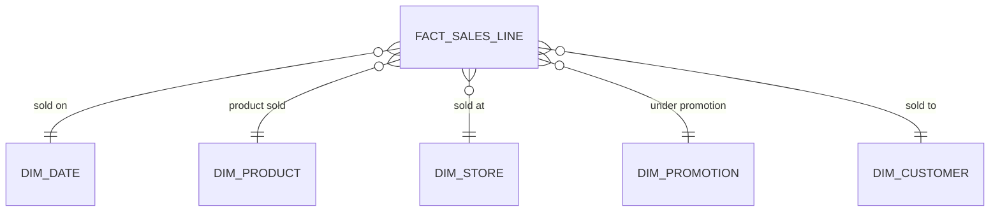

# Kimball Dimensional Modelling

## Contents

1. [What Kimball Modelling Is](#1-what-kimball-modelling-is)
2. [Fundamental Concepts](#2-fundamental-concepts)
3. [Fact Table Techniques](#3-fact-table-techniques)
4. [Dimension Table Techniques](#4-dimension-table-techniques)
5. [Integration via Conformed Dimensions](#5-integration-via-conformed-dimensions)
6. [Slowly Changing Dimensions](#6-slowly-changing-dimensions)
7. [Dimension Hierarchies](#7-dimension-hierarchies)
8. [Advanced Fact Table Techniques](#8-advanced-fact-table-techniques)
9. [Advanced Dimension Table Techniques](#9-advanced-dimension-table-techniques)
10. [Special Purpose Schemas](#10-special-purpose-schemas)
11. [Worked Example: Retail Sales Mart](#11-worked-example-retail-sales-mart)
12. [Loading a Dimensional Model](#12-loading-a-dimensional-model)
13. [Querying, Performance and Physical Design](#13-querying-performance-and-physical-design)
14. [Kimball in the Modern Data Stack](#14-kimball-in-the-modern-data-stack)
15. [Pitfalls and Anti-Patterns](#15-pitfalls-and-anti-patterns)
16. [Design Review Checklist](#16-design-review-checklist)
17. [Technique Selection Cheat Sheet](#17-technique-selection-cheat-sheet)
18. [Glossary](#18-glossary)

## 1. What Kimball Modelling Is

Dimensional modelling organises analytical data into **facts** (numeric measurements of business events) surrounded by **dimensions** (the descriptive context: who, what, where, when, why, how). Ralph Kimball introduced it to the data warehouse and BI world with *The Data Warehouse Toolkit* in 1996, and the Kimball Group has refined the technique catalogue since.

It has two stated objectives: **simplicity** (business users can understand the model and navigate it without help) and **speed** (queries are predictable and fast). Nearly every technique in this guide serves one of those two goals.

### 1.1 Architecture in one picture


- **ETL Back Room**: staging and transformation. Not meant for business users.
- **Presentation Area**: the dimensional models (star schemas, OLAP cubes). This is what users query, so it must be dimensional, atomic where possible, and organised around business processes with shared conformed dimensions (the *bus architecture*).
- **BI Layer**: tools and applications that read the presentation area.

The terms "back room" and "presentation area" come from Kimball's wider lifecycle books rather than the techniques summary, but they describe the architecture the techniques assume.

### 1.2 Core principles

1. **Model a business process**, not a department or a report.
2. **Declare the grain** before choosing anything else, and never mix grains in one fact table.
3. **Keep data atomic** wherever you can; add aggregates for speed, never instead of detail.
4. **Denormalise dimensions** into wide, flat, descriptive tables.
5. **Own your keys**: use warehouse-controlled surrogate keys, not source keys.
6. **Integrate through conformed dimensions** defined once and reused.
7. **Build incrementally**, one business process (one bus matrix row) at a time.
8. **Design for graceful change**: new facts, dimensions and attributes should not break existing queries.

### 1.3 When it fits

**Good fit:**

- Analytical and reporting workloads where business users or BI tools query the data directly.
- A need for consistent, shared definitions of customers, products, dates and so on across subject areas.
- Teams that want an incremental delivery path with visible value per business process.
- Slicing, filtering, grouping and drilling are the dominant access patterns.

**Weaker fit:**

- Raw, schema-on-read exploration of unmodelled data (use a lake zone first, model later).
- Heavy auditability of *as-delivered* source data with full source lineage. A dimensional model applies business rules and conforming; pair it with a raw/integration layer such as Data Vault or a persistent staging zone.
- Operational, transaction-by-transaction lookups. Dimensional models serve analysis, not OLTP.

### 1.4 How it relates to other approaches

| Aspect | Kimball dimensional | Inmon 3NF warehouse | Data Vault |
| --- | --- | --- | --- |
| Primary goal | Fast, understandable analytics | Normalised enterprise truth | Auditable integration layer |
| Structures | Facts and dimensions | Normalised entities | Hubs, links, satellites |
| Where users query | Directly | Usually via marts | Never directly; via marts |
| Business rules | Applied while loading | Applied while loading | Pushed downstream |
| Typical layer | Presentation | Integration | Integration/raw |

These are complementary. A common modern pattern is **Data Vault or a persistent staging layer for integration and history, with Kimball star schemas as the presentation layer**.

## 2. Fundamental Concepts

### 2.1 Gather business requirements and data realities

Before drawing any table, learn two things in parallel:

- **Business requirements**: interview business representatives about objectives, KPIs, pressing problems, decision processes and the analytics that support them.
- **Data realities**: meet source-system experts and run high-level data profiling to find out what the data can actually support.

A model that satisfies requirements but not data realities cannot be loaded; a model driven only by the data ignores what the business needs. Profiling at this stage is cheap and catches problems early:

```sql
-- Quick profile of a candidate source table
SELECT COUNT(*)                                             AS row_count,
       COUNT(DISTINCT customer_number)                      AS distinct_keys,
       SUM(CASE WHEN customer_number IS NULL THEN 1 ELSE 0 END) AS null_keys,
       SUM(CASE WHEN email IS NULL THEN 1 ELSE 0 END)       AS null_email,
       MIN(created_at) AS first_record, MAX(created_at) AS last_record
FROM src_crm.customers;
```

Questions to answer: is the candidate natural key actually unique and stable? How are deletes represented? Which attributes are populated often enough to be useful?

### 2.2 Collaborative modelling workshops

Dimensional models are designed **with** subject-matter experts and data governance representatives, in a series of interactive workshops. The modeller leads, but the business shapes the content: attribute names, domain values, rules, definitions. Models designed in isolation by people who do not know the business are the most common cause of rejected warehouses. Workshops double as further requirements gathering.

A useful side-tool is the **opportunity/stakeholder matrix** (section 5.7), which tells you which business groups to invite to which workshop.

### 2.3 The four-step design process

Four decisions, made in this order, define a dimensional model:

| Step | Decision | Retail POS example |
| --- | --- | --- |
| 1 | Select the business process | Retail sales at the checkout |
| 2 | Declare the grain | One row per product on a POS transaction line |
| 3 | Identify the dimensions | Date, product, store, promotion, customer, cashier |
| 4 | Identify the facts | Quantity sold, extended sales amount, extended cost amount, discount amount |

The answers come from combining business needs with data realities during the workshops. Afterwards the team settles table and column names, sample domain values and business rules, with data governance participating so the business buys in.

### 2.4 Business processes

A **business process** is an operational activity the organisation performs: taking an order, processing an insurance claim, registering students for a class, snapshotting every account each month. Processes generate or capture the measurements that become facts. Most fact tables describe a single process.

Choosing the process matters because it defines a concrete design target and makes it possible to declare a grain, dimensions and facts. Each process corresponds to **one row of the enterprise data warehouse bus matrix** (section 5.6).

Tips:

- A process is a verb (order, ship, bill, pay), not a department (Sales, Finance) and not a report ("Monthly KPI pack").
- Name processes the way the business does.
- If two groups argue about the numbers, they probably describe two different processes or grains.

### 2.5 Grain

Declaring the grain is the pivotal step. The **grain states exactly what one fact table row represents**. It is a binding contract: every dimension and every fact added later must be consistent with it. This uniformity is what makes dimensional models fast and easy to use.

- **Atomic grain** is the lowest level at which a process captures data. Start there: atomic data survives unpredictable questions, whereas pre-summarised grains presuppose what the business will ask.
- Each distinct grain gets its **own physical fact table**. Do not mix grains in one table.

| Weak grain statement | Declarative grain statement |
| --- | --- |
| "Sales data" | One row per product line on a point-of-sale transaction |
| "Daily orders" | One row per order line, per day it was shipped |
| "Account information" | One row per account per month-end |
| "Customer activity" | One row per customer contact event (call, email, chat) |

A good test is whether you can describe a row in one sentence without the word "or". A second test is mechanical: the combination of dimension keys plus any degenerate keys that you believe identifies a row must actually be unique.

```sql
-- Grain check: this should return zero rows
SELECT pos_transaction_number, line_number, COUNT(*) AS duplicates
FROM fact_sales_line
GROUP BY pos_transaction_number, line_number
HAVING COUNT(*) > 1;
```

A classic grain mistake is placing a header-level amount (a freight charge for the whole order) on every line row, so summing it double counts. See *allocated facts*, section 8.5.

### 2.6 Dimensions provide descriptive context

Dimensions supply the who, what, where, when, why and how around a measurement event. Their attributes are what BI applications use for **filtering and grouping**, and their values become the row and column headers on reports. With the grain fixed, every candidate dimension is tested for consistency with it, ideally being **single-valued per fact row**.

Dimension tables are sometimes called the "soul" of the warehouse because they hold the entry points and descriptive labels that make the data usable. Spend a disproportionate share of effort on governance and quality of dimension content: it drives the user experience.

### 2.7 Facts are measurements

Facts are the measurements resulting from a process event, almost always numeric. One fact row corresponds to one measurement event at the declared grain, so a fact table mirrors a **physical, observable event**, not the needs of one report. Only facts consistent with the grain are allowed: in a retail sales line, quantity and extended price are valid facts; an attribute that belongs to a different grain, such as a store manager's salary, is not.

### 2.8 Star schemas and OLAP cubes

A **star schema** is a dimensional structure in a relational database: a central fact table with foreign keys to surrounding dimension tables. An **OLAP cube** is a dimensional structure in a multidimensional engine. It may mirror a star schema or, more often, be derived from one, and is queried with languages richer than SQL (such as MDX/XMLA). Cubes are often the final deployment step or serve as aggregate structures on top of an atomic star.



A typical star query filters on dimension attributes and groups by others:

```sql
SELECT d.calendar_month_name, p.category_name, SUM(f.extended_sales_amount) AS sales_amount
FROM fact_sales_line f
JOIN dim_date    d ON d.date_key    = f.date_key
JOIN dim_product p ON p.product_key = f.product_key
JOIN dim_store   s ON s.store_key   = f.store_key
WHERE d.calendar_year = 2026
  AND s.region_name   = 'West'
GROUP BY d.calendar_month_name, p.category_name;
```

Every query follows this shape, which is why BI tools and users learn it once.

### 2.9 Graceful extensions

Dimensional models tolerate change. All of the following can be made **without altering any existing BI query, application or query result**:

| Change | How |
| --- | --- |
| Add a fact consistent with the grain | New column in the fact table |
| Add a dimension that does not change the grain | New foreign key column in the fact table |
| Add an attribute to a dimension | New column in the dimension table |
| Make the grain more atomic | Add attributes to existing dimensions, then restate the fact table at the lower grain, preserving existing column names |

```sql
-- New fact at the existing grain
ALTER TABLE fact_sales_line ADD COLUMN extended_tax_amount NUMERIC(12,2);

-- New dimension: add the key, defaulting existing rows to the Unknown member (key 0)
ALTER TABLE fact_sales_line ADD COLUMN cashier_key INTEGER NOT NULL DEFAULT 0;

-- New descriptive attribute
ALTER TABLE dim_product ADD COLUMN package_type VARCHAR(40) DEFAULT 'Unknown';
```

This resilience is a major reason dimensional models outlast the first project.

## 3. Fact Table Techniques

### 3.1 Fact table structure

A fact table holds the numeric measures produced by an operational measurement event. At the lowest grain, **one row corresponds to one event and vice versa**, so the design follows a physical activity, not the reports that will eventually be written. A fact table always contains:

- a **foreign key to each associated dimension**;
- the **numeric measures** (facts);
- optionally, **degenerate dimension keys** (transaction or document numbers with no dimension table);
- optionally, **date/time stamps** for precision beyond the date dimension.

Fact tables are the main target of computation and dynamic aggregation, and they are usually the largest tables in the warehouse.

```sql
CREATE TABLE fact_sales_line (
  date_key                 INTEGER       NOT NULL,  -- FK to dim_date
  product_key              INTEGER       NOT NULL,  -- FK to dim_product
  store_key                INTEGER       NOT NULL,  -- FK to dim_store
  promotion_key            INTEGER       NOT NULL,  -- FK to dim_promotion
  customer_key             INTEGER       NOT NULL,  -- FK to dim_customer
  pos_transaction_number   VARCHAR(30)   NOT NULL,  -- degenerate dimension
  line_number              INTEGER       NOT NULL,  -- degenerate dimension
  sale_ts                  TIMESTAMP     NOT NULL,  -- precise time, a plain column
  sales_quantity           INTEGER,
  extended_sales_amount    NUMERIC(12,2),
  extended_discount_amount NUMERIC(12,2),
  extended_cost_amount     NUMERIC(12,2),
  gross_profit_amount      NUMERIC(12,2)
);
```

### 3.2 Additive, semi-additive and non-additive facts

| Kind | Rule | Example |
| --- | --- | --- |
| **Additive** | Can be summed across every dimension | Sales amount, quantity sold |
| **Semi-additive** | Can be summed across some dimensions but not all | Account balance, inventory on hand: not summable across time |
| **Non-additive** | Cannot be meaningfully summed | Ratios, percentages, unit prices |

Prefer additive facts. For a non-additive measure, **store its additive components and compute the ratio after summing**, usually in the BI layer or cube.

```sql
-- Wrong: averaging a stored ratio gives each row equal weight
SELECT AVG(gross_margin_pct) FROM fact_sales_line;

-- Right: sum the components, then divide
SELECT SUM(gross_profit_amount) / NULLIF(SUM(extended_sales_amount), 0) AS gross_margin_pct
FROM fact_sales_line;
```

Semi-additive balances need a different aggregation across time:

```sql
-- Month-end balances: summing across ACCOUNTS for one month is valid...
SELECT SUM(balance_amount) FROM fact_account_month WHERE month_end_date_key = 20260930;

-- ...but across MONTHS use an average (per account), or the last value, never SUM
SELECT SUM(avg_balance) AS total_average_balance
FROM (SELECT account_key, AVG(balance_amount) AS avg_balance
      FROM fact_account_month
      WHERE month_end_date_key BETWEEN 20260101 AND 20261231
      GROUP BY account_key) t;
```

Document the additivity of each fact in the model, because BI tools will otherwise sum everything.

### 3.3 Nulls in fact tables

- **Null measures are fine.** SUM, COUNT, MIN, MAX and AVG all handle them sensibly.
- **Null foreign keys are not.** A null key breaks referential integrity and silently drops rows from inner joins. Every dimension gets a **default row with its own surrogate key** meaning Unknown or Not Applicable, and the fact row points to it.

```sql
INSERT INTO dim_customer (customer_key, customer_number, customer_name, customer_city, row_effective_ts, row_expiration_ts, current_row_flag)
VALUES (0, 'UNKNOWN', 'Unknown', 'Unknown', TIMESTAMP '1900-01-01', TIMESTAMP '9999-12-31', 'Current'),
       (-1, 'NA', 'Not Applicable', 'Not Applicable', TIMESTAMP '1900-01-01', TIMESTAMP '9999-12-31', 'Current');
```

Use **Unknown** when a value exists but is not known yet; use **Not Applicable** when the dimension genuinely does not apply to this event (for example, a promotion key on a non-promoted sale).

### 3.4 Conformed facts

If the same measure appears in several fact tables, make sure its technical definition is identical wherever the numbers will be compared or combined. When definitions agree, give the columns **the same name**. When they differ (for example, revenue before versus after returns), give them **different names** so users and tools are not misled.

### 3.5 Transaction fact tables

A row represents a **measurement event at a point in space and time** (one scan at a register, one payment, one shipment line). Atomic transaction fact tables are the most dimensional and expressive, supporting the widest slicing and dicing. They are **dense or sparse**: rows exist only when something happened. They always have a foreign key for each dimension and often precise timestamps and degenerate keys. The facts must be consistent with the transaction grain.

### 3.6 Periodic snapshot fact tables

A row summarises **many events over a standard period** (day, week, month): for example, every account's balance and activity at month-end. The grain is the period, not the transaction. Characteristics:

- Often carry **many facts**, since any measure consistent with the period grain is allowed.
- **Uniformly dense**: even when nothing happened, a row is typically inserted with zero (or null) facts, so absence is distinguishable from a missing load.
- Usually semi-additive balances plus additive period activity (deposits, withdrawals).

```sql
CREATE TABLE fact_account_month (
  month_end_date_key INTEGER NOT NULL,
  account_key        INTEGER NOT NULL,
  branch_key         INTEGER NOT NULL,
  balance_amount     NUMERIC(14,2),   -- semi-additive
  deposits_amount    NUMERIC(14,2),   -- additive within the month
  withdrawals_amount NUMERIC(14,2),
  transaction_count  INTEGER
);
```

### 3.7 Accumulating snapshot fact tables

A row tracks **one instance of a pipeline process from start to end**, such as an order line moving through order, pick, ship and delivery, or an insurance claim. It suits processes with a defined start, standard intermediate milestones and a defined end. Key features:

- One **date foreign key per milestone** (role-playing the date dimension).
- The row is **inserted when the pipeline starts and updated as milestones occur**. This revisiting of rows is unique to accumulating snapshots among the three fact types.
- Foreign keys to other dimensions, optional degenerate keys, **lag measurements** and **milestone completion counters**.
- Milestones not yet reached point to a special "to be determined" date row.

```sql
CREATE TABLE fact_order_fulfillment (
  order_number          VARCHAR(30) NOT NULL,   -- degenerate
  order_line_number     INTEGER     NOT NULL,   -- degenerate
  product_key           INTEGER     NOT NULL,
  customer_key          INTEGER     NOT NULL,
  warehouse_key         INTEGER     NOT NULL,
  order_date_key        INTEGER     NOT NULL,
  pick_date_key         INTEGER     NOT NULL DEFAULT 99991231,  -- "not yet occurred" row
  ship_date_key         INTEGER     NOT NULL DEFAULT 99991231,
  delivery_date_key     INTEGER     NOT NULL DEFAULT 99991231,
  order_quantity        INTEGER,
  shipped_quantity      INTEGER,
  pick_lag_days         INTEGER,      -- lags measured from the process start
  ship_lag_days         INTEGER,
  delivery_lag_days     INTEGER,
  shipped_flag          SMALLINT DEFAULT 0,   -- milestone counters
  delivered_flag        SMALLINT DEFAULT 0
);

-- A shipment event arrives: revisit and update the existing row
UPDATE fact_order_fulfillment
SET ship_date_key    = :ship_date_key,
    shipped_quantity = :qty,
    ship_lag_days    = :ship_date - :order_date,
    shipped_flag     = 1
WHERE order_number = :order_number AND order_line_number = :line_number;

-- Any lag between two milestones is a subtraction of two stored lags
SELECT AVG(delivery_lag_days - ship_lag_days) AS avg_days_in_transit
FROM fact_order_fulfillment WHERE delivered_flag = 1;
```

Storing every lag against the start (rather than every pair of milestones) keeps the table narrow: with dozens of steps there could be hundreds of pairs.

### 3.8 Factless fact tables

Sometimes an event just records that dimensional entities came together: a student attended a class on a date, a customer received a communication. The row has foreign keys but **no numeric fact** (often a constant `1` column is added to make counting easier).

They also answer **"what did not happen"** questions through two parts: a **coverage** table listing everything that could have happened and an **activity** table listing what did; subtract the activity from the coverage.

```sql
-- fact_promo_coverage: every product on promotion, per store and day (the "could have sold" set)
-- Which promoted products did NOT sell in the store on the promotion day?
SELECT c.store_key, c.product_key
FROM fact_promo_coverage c
WHERE c.date_key = 20261024
  AND c.promotion_key = 77
  AND NOT EXISTS (
        SELECT 1 FROM fact_sales_line s
        WHERE s.date_key      = c.date_key
          AND s.store_key     = c.store_key
          AND s.product_key   = c.product_key
          AND s.promotion_key = c.promotion_key);
```

This is a set subtraction between coverage and activity, not the forbidden measure-producing fact-to-fact join of section 8.10.

### 3.9 Aggregate fact tables and cubes

Aggregate fact tables are **simple numeric rollups of atomic facts built solely to speed queries**. Rules:

- They live alongside the atomic tables and are available to the BI layer at the same time.
- **Aggregate navigation** must be *open*: any tool or report writer picks the best aggregate automatically, so no one writes SQL against a specific aggregate. A good aggregate behaves like an index: it speeds queries but is invisible to users.
- They use **shrunken conformed dimensions** and sums from the atomic fact table.
- **Aggregate OLAP cubes** are built the same way but are queried directly by business users.

```sql
CREATE TABLE agg_sales_month_brand AS
SELECT d.calendar_month_key, p.brand_key,
       SUM(f.sales_quantity)         AS sales_quantity,
       SUM(f.extended_sales_amount)  AS extended_sales_amount
FROM fact_sales_line f
JOIN dim_date    d ON d.date_key    = f.date_key
JOIN dim_product p ON p.product_key = f.product_key
GROUP BY d.calendar_month_key, p.brand_key;
-- dim_month and dim_brand are shrunken rollups of dim_date and dim_product (section 5.2)
```

When type 1 changes overwrite attributes that aggregates depend on, the aggregates must be rebuilt.

### 3.10 Consolidated fact tables

Facts from several processes can be combined into one **consolidated fact table** if they can be expressed at the **same grain**, for example sales actuals alongside sales forecasts at month by brand by region. Analysis such as actual versus forecast becomes simple and fast compared with drilling across separate tables. The cost is extra ETL work, so reserve it for cross-process metrics that are analysed together often.

### 3.11 The three fact grains compared

| Aspect | Transaction | Periodic snapshot | Accumulating snapshot |
| --- | --- | --- | --- |
| One row is | One event | One period for an entity | One pipeline instance |
| Row inserted | When the event occurs | Every period | When the pipeline starts |
| Rows updated later | No | No | Yes, as milestones occur |
| Density | Sparse or dense | Uniformly dense | One row per instance |
| Dates | One date key (plus timestamp) | Period-end date key | Several milestone date keys |
| Typical facts | Amounts, quantities | Balances, period totals | Lags, counters, milestone amounts |
| Example | POS line | Account month-end | Order line fulfilment |

Many business processes need more than one of these on the same data (for instance transaction lines plus a periodic inventory snapshot). Build each at its own grain.

## 4. Dimension Table Techniques

### 4.1 Dimension table structure

Each dimension table has **one primary key column**, embedded as a foreign key in every fact table where the dimension row's context is exactly right for that fact row. Dimension tables are typically **wide, flat, denormalised** and full of low-cardinality text attributes. Codes and flags are fine as attributes, but the most valuable attributes carry verbose descriptions. These attributes are the primary target of query constraints and grouping, and their values become report labels.

```sql
CREATE TABLE dim_product (
  product_key          INTEGER GENERATED BY DEFAULT AS IDENTITY PRIMARY KEY,  -- surrogate key (BY DEFAULT so special rows can set 0 and -1)
  product_durable_key  INTEGER      NOT NULL,   -- supernatural key, stable across type 2 rows
  product_number       VARCHAR(30)  NOT NULL,   -- natural key from the source (SKU)
  product_name         VARCHAR(200) NOT NULL,
  brand_name           VARCHAR(100) NOT NULL,
  subcategory_name     VARCHAR(100) NOT NULL,
  category_name        VARCHAR(100) NOT NULL,
  department_name      VARCHAR(100) NOT NULL,
  package_type         VARCHAR(40)  NOT NULL DEFAULT 'Unknown',
  diet_type            VARCHAR(40)  NOT NULL DEFAULT 'Not Applicable',
  list_price_band      VARCHAR(30)  NOT NULL DEFAULT 'Unknown',
  row_effective_ts     TIMESTAMP    NOT NULL,   -- type 2 housekeeping (section 6)
  row_expiration_ts    TIMESTAMP    NOT NULL,
  current_row_flag     VARCHAR(10)  NOT NULL
);
```

### 4.2 Dimension surrogate keys

The primary key of a dimension is **not** the source system's natural key, for three reasons: tracking history produces several dimension rows per natural key; several source systems may supply conflicting or poorly governed natural keys; and the warehouse must control its own keys. So every dimension gets an **anonymous integer surrogate key**, assigned sequentially (starting at 1) whenever a new row is needed. Do not build "smart" keys from natural keys plus dates.

**Exception:** the date dimension can use a meaningful key such as `YYYYMMDD`, because it is stable and predictable. That helps partitioning, but filters and groupings should still use the dimension's attributes, never decode the smart key.

### 4.3 Natural, durable and supernatural keys

- **Natural key**: the source system's identifier. It is subject to business rules outside your control. An employee number may change when someone resigns and is rehired.
- **Durable (supernatural) key**: a warehouse-generated key, ideally a sequential integer independent of the original business process, that **never changes** for the real-world entity.
- **Surrogate key**: changes with each type 2 row.

An entity therefore has one durable key and potentially many surrogate keys over time. The durable key is what you use to follow an entity across versions (section 6, types 6 and 7) and to define study groups (section 9.4).

### 4.4 Drilling down

Drilling down is the most basic way users analyse data: **add a row header to an existing query**. In SQL, that means appending a dimension attribute to `GROUP BY`. The attribute can come from any dimension attached to the fact table, and no predefined hierarchy or drill path is needed.

```sql
-- Start:      GROUP BY category_name
-- Drill down: GROUP BY category_name, brand_name      (just add a header)
-- Pivot to another dimension: GROUP BY category_name, store_region
```

### 4.5 Degenerate dimensions

A degenerate dimension is a dimension key with **no associated dimension table** because it has no attributes of its own: an invoice or POS transaction number on a line-level fact table. The line rows inherit all the invoice's descriptive foreign keys, so the invoice itself is left with nothing else to say, yet the number remains valuable for grouping lines into baskets and for tracing back to the source. Degenerate dimensions are most common in transaction and accumulating snapshot fact tables, and are placed directly in the fact table.

```sql
-- Basket analysis uses the degenerate key directly
SELECT AVG(basket_amount) FROM (
  SELECT pos_transaction_number, SUM(extended_sales_amount) AS basket_amount
  FROM fact_sales_line GROUP BY pos_transaction_number) t;
```

### 4.6 Denormalised flattened dimensions

Resist the normalisation habits formed in operational database design. Collapse **many-to-one, fixed-depth hierarchies** into separate columns of one flat dimension row: product, brand, category and department all sit on the product row. Denormalisation serves the two goals of simplicity and speed.

### 4.7 Multiple hierarchies in one dimension

A dimension often has several natural hierarchies: a date has day-week-fiscal period and day-month-year; a location may have several geographic hierarchies. They **coexist** in the same table as separate sets of columns.

### 4.8 Flags and indicators as text attributes

Replace cryptic abbreviations, true/false flags and operational indicators with **full-text values meaningful on their own** ("Gift order" instead of `Y`). Operational codes with meaning embedded in the code value should be **split into separate descriptive attributes**.

| Source value | Weak attribute | Better attribute |
| --- | --- | --- |
| `GFT_FLG = 'Y'` | `Y` | `Gift order` / `Not a gift order` |
| `PRD_CD = 'EL-TV-55-4K'` | `EL-TV-55-4K` | `department = Electronics`, `category = Television`, `screen_size = 55 inch`, `resolution = 4K` |

### 4.9 Null attributes in dimensions

Nulls in dimension attributes arise when a row is not fully populated or when an attribute does not apply. **Replace them with descriptive strings** such as `Unknown` or `Not Applicable`, because different databases and BI tools group and filter nulls inconsistently.

```sql
UPDATE dim_product SET diet_type = 'Not Applicable' WHERE diet_type IS NULL AND department_name <> 'Food';
UPDATE dim_product SET diet_type = 'Unknown'        WHERE diet_type IS NULL;
```

### 4.10 Calendar date dimension

A date dimension joins virtually every fact table. It carries the attributes users know: day of week, month name, fiscal period, national holidays, special days. **Look up Easter, never compute it in SQL.** Guidelines:

- Primary key may be a `YYYYMMDD` integer to ease partitioning; the table needs **special rows** for unknown and to-be-determined dates.
- Filter and group on **attributes**, not on the smart key.
- If you need more precision, add a **date/time stamp as a plain column** in the fact table (not a key).
- If users filter by time of day (day part, shift), add a separate **time-of-day dimension** key.

```sql
CREATE TABLE dim_date (
  date_key              INTEGER     PRIMARY KEY,   -- YYYYMMDD
  full_date             DATE        NOT NULL,
  day_of_week_name      VARCHAR(10) NOT NULL,
  day_of_week_number    SMALLINT    NOT NULL,
  weekday_indicator     VARCHAR(10) NOT NULL,      -- 'Weekday' / 'Weekend'
  calendar_month_key    INTEGER     NOT NULL,      -- YYYYMM, supports a shrunken month dimension
  calendar_month_name   VARCHAR(10) NOT NULL,
  calendar_quarter      VARCHAR(2)  NOT NULL,
  calendar_year         SMALLINT    NOT NULL,
  fiscal_period         VARCHAR(10) NOT NULL,
  holiday_indicator     VARCHAR(20) NOT NULL,      -- 'Holiday' / 'Not a holiday'
  holiday_name          VARCHAR(60) NOT NULL DEFAULT 'Not Applicable'
);

INSERT INTO dim_date (date_key, full_date, day_of_week_name, day_of_week_number, weekday_indicator,
                      calendar_month_key, calendar_month_name, calendar_quarter, calendar_year,
                      fiscal_period, holiday_indicator)
SELECT TO_CHAR(g.d, 'YYYYMMDD')::INT, g.d::DATE, TRIM(TO_CHAR(g.d, 'Day')), EXTRACT(ISODOW FROM g.d),
       CASE WHEN EXTRACT(ISODOW FROM g.d) IN (6,7) THEN 'Weekend' ELSE 'Weekday' END,
       TO_CHAR(g.d, 'YYYYMM')::INT, TRIM(TO_CHAR(g.d, 'Month')), 'Q' || EXTRACT(QUARTER FROM g.d),
       EXTRACT(YEAR FROM g.d), 'FY' || EXTRACT(YEAR FROM g.d) || '-P' || LPAD(EXTRACT(MONTH FROM g.d)::TEXT, 2, '0'),
       'Not a holiday'
FROM generate_series(DATE '2020-01-01', DATE '2035-12-31', INTERVAL '1 day') AS g(d);

-- Special members
INSERT INTO dim_date (date_key, full_date, day_of_week_name, day_of_week_number, weekday_indicator,
                      calendar_month_key, calendar_month_name, calendar_quarter, calendar_year,
                      fiscal_period, holiday_indicator, holiday_name)
VALUES (0,        DATE '1900-01-01', 'Unknown',        0, 'Unknown',        0,      'Unknown',        'NA', 1900, 'Unknown',        'Unknown',        'Unknown'),
       (99991231, DATE '9999-12-31', 'Not yet',        0, 'Not yet',        999912, 'Not yet',        'NA', 9999, 'Not yet',        'Not yet',        'Not yet');
```

Holidays and fiscal calendars come from a business-owned reference table and are updated, not computed.

### 4.11 Role-playing dimensions

One physical dimension can appear **several times in the same fact table**, each in a different role: order date, ship date and delivery date all reference the date dimension. Each foreign key must point to **its own view** of the dimension, with uniquely named columns, so that the roles stay independent in BI tools.

```sql
CREATE VIEW dim_order_date AS
SELECT date_key AS order_date_key, full_date AS order_full_date,
       calendar_month_name AS order_month_name, calendar_year AS order_year
FROM dim_date;

CREATE VIEW dim_ship_date AS
SELECT date_key AS ship_date_key, full_date AS ship_full_date,
       calendar_month_name AS ship_month_name, calendar_year AS ship_year
FROM dim_date;
```

### 4.12 Junk dimensions

Transactional processes throw off miscellaneous **low-cardinality flags and indicators** (payment type, channel, gift flag, coupon used). Instead of a dimension per flag, or a trail of flag columns in the fact table, combine them in a single **junk dimension** (also called a *transaction profile dimension*). It holds only the **combinations that actually occur** in the data, not the full Cartesian product.

```sql
INSERT INTO dim_order_profile (order_profile_key, payment_type, order_channel, gift_indicator, coupon_indicator)
SELECT ROW_NUMBER() OVER (ORDER BY payment_type, order_channel, gift_indicator, coupon_indicator),
       payment_type, order_channel, gift_indicator, coupon_indicator
FROM (SELECT DISTINCT
             COALESCE(payment_type, 'Unknown')                                    AS payment_type,
             COALESCE(channel, 'Unknown')                                         AS order_channel,
             CASE WHEN gift_flag = 'Y' THEN 'Gift order' ELSE 'Not a gift order' END AS gift_indicator,
             CASE WHEN coupon_code IS NOT NULL THEN 'Coupon used' ELSE 'No coupon' END AS coupon_indicator
      FROM stg_order_lines) s;
```

The fact table then carries one `order_profile_key` rather than four flag keys, which also avoids the *centipede* anti-pattern (section 8.2).

### 4.13 Snowflaked dimensions

Normalising a dimension's hierarchies into secondary tables (product to brand to category in separate tables) creates a **snowflake**. It represents the data accurately but is harder for users to understand and navigate and can hurt query performance. A flattened dimension holds exactly the same information. **Avoid snowflakes** in the presentation area, though normalised structures are fine in the ETL back room.

### 4.14 Outrigger dimensions

A dimension can reference another dimension: a bank-account dimension referencing a date dimension for the account-open date. These secondary references are **outriggers**. They are allowed but should be **used sparingly**. Usually the correlation between two dimensions is better represented by putting both as separate foreign keys in a fact table (see dimension-to-dimension joins, section 9.1).

## 5. Integration via Conformed Dimensions

### 5.1 Conformed dimensions

Dimensions **conform** when the same attributes in separate dimension tables have the **same column names and the same domain contents**. Separate fact tables can then be combined in one report using conformed attributes as the row headers. When a conformed attribute is the `GROUP BY` column, answers from different fact tables line up on the same rows. That is the essence of integration in a dimensional warehouse.

Conformed dimensions are **defined once**, in collaboration with business data governance representatives, then reused by every fact table that needs them. This gives analytic consistency and lowers future development cost, because each new process plugs into existing dimensions instead of reinventing them.

Practical tests for conformance:

- Same column names for the shared attributes (`brand_name` everywhere, not `brand` in one place and `brand_desc` in another).
- Same value domains (`Electronics`, not `ELEC` in one dimension and `Electronic goods` in another).
- Same grain of the dimension row (one row per product, not one per product-package in one place and per product in another), unless one is a deliberate subset (next section).

### 5.2 Shrunken rollup dimensions

A **shrunken dimension** is a conformed dimension containing a *subset of the rows and/or columns* of a base dimension. They are needed for:

- **Aggregate fact tables** (month instead of date, brand instead of product).
- Processes that **naturally capture data at a higher level** than the atomic dimension, such as a sales forecast by month and brand.
- Two dimensions at the same level of detail where one covers only a subset of rows (for example, a dimension of only the products sold online).

```sql
-- Shrunken rollup: brand level of the product dimension (conforms because names and values match)
CREATE TABLE dim_brand AS
SELECT ROW_NUMBER() OVER (ORDER BY brand_name) AS brand_key,
       brand_name, department_name
FROM (SELECT DISTINCT brand_name, department_name FROM dim_product WHERE current_row_flag = 'Current') b;

CREATE TABLE dim_month AS
SELECT DISTINCT calendar_month_key AS month_key, calendar_month_name, calendar_quarter, calendar_year
FROM dim_date WHERE date_key NOT IN (0, 99991231);
```

### 5.3 Drilling across

**Drilling across** means issuing **separate queries to two or more fact tables**, with row headers made of identical conformed attributes, then **merging the answer sets on those headers**. BI vendors call it "stitch" or "multipass" queries. The key point: never join the fact tables to each other (section 8.10); join each to the conformed dimensions independently and merge.

```sql
-- Retail sales vs month-end store inventory by brand for October 2026
WITH sales AS (
  SELECT p.brand_name, SUM(f.extended_sales_amount) AS sales_amount
  FROM fact_sales_line f
  JOIN dim_product p ON p.product_key = f.product_key
  JOIN dim_date    d ON d.date_key    = f.date_key
  WHERE d.calendar_month_key = 202610
  GROUP BY p.brand_name),
inventory AS (
  SELECT p.brand_name, SUM(f.quantity_on_hand) AS units_on_hand       -- semi-additive: one snapshot date only
  FROM fact_inventory_snapshot f
  JOIN dim_product p ON p.product_key = f.product_key
  WHERE f.date_key = 20261031
  GROUP BY p.brand_name)
SELECT COALESCE(s.brand_name, i.brand_name) AS brand_name,
       s.sales_amount, i.units_on_hand
FROM sales s
FULL OUTER JOIN inventory i ON i.brand_name = s.brand_name;
```

The `FULL OUTER JOIN` plays the role of the sort-merge: brands present in only one process still appear.

### 5.4 Value chain

A **value chain** is the natural flow of an organisation's primary business processes: a retailer's purchasing, warehousing, retail sales; a general ledger's budgeting, commitments, payments. Each step typically produces its own transactions or snapshots with unique metrics, timing, grain and dimensionality, so **each process spawns at least one atomic fact table**. The value chain gives you the list of rows for the bus matrix.

### 5.5 Enterprise data warehouse bus architecture

The **bus architecture** is an incremental approach to building the enterprise warehouse. It breaks the planning problem into manageable pieces by focusing on business processes, while achieving integration through **standardised conformed dimensions** reused across processes. It provides an architectural framework and also decomposes the programme into agile increments, one per row of the bus matrix. It is independent of technology and platform; relational stars and OLAP cubes can both plug into the same bus. The analogy is a hardware bus: any process (a "card") that adheres to the shared dimensions (the "slots") can connect.

### 5.6 Enterprise data warehouse bus matrix

The bus matrix is the key planning and communication tool. **Rows are business processes; columns are dimensions; marked cells show which dimensions participate in which process.**

| Business process | Date | Product | Store | Promotion | Customer | Vendor | Warehouse | Employee |
| --- | :-: | :-: | :-: | :-: | :-: | :-: | :-: | :-: |
| Purchase orders | X | X | | | | X | X | X |
| Warehouse inventory | X | X | | | | X | X | |
| Store inventory | X | X | X | | | | | |
| Retail sales | X | X | X | X | X | | | X |
| Retail returns | X | X | X | | X | | | X |
| Customer service | X | X | X | | X | | | X |

How to use it:

- **Scan each row** to test whether a candidate dimension is well defined for that process.
- **Scan each column** to see where a dimension must be conformed across processes. Columns with many marks are your highest-value conformed dimensions (Date and Product above).
- **Prioritise with management**: implement one row at a time, in the order that delivers the most business value.

The **detailed implementation bus matrix** expands each process row into its specific fact tables or cubes, where the exact grain statement and list of facts can be documented:

| Process | Fact table | Grain | Key facts |
| --- | --- | --- | --- |
| Retail sales | `fact_sales_line` | One row per product on a POS transaction line | Quantity, sales, discount, cost |
| Store inventory | `fact_inventory_snapshot` | One row per product per store per day | Quantity on hand, quantity sold |
| Order fulfilment | `fact_order_fulfillment` | One row per order line | Quantities, pick, ship and delivery lags |

### 5.7 Opportunity/stakeholder matrix

After the matrix rows are identified, draft a second matrix: replace the dimension columns with **business functions** (marketing, sales, finance) and shade the cells showing which functions care about which processes. It tells you which groups to invite to the collaborative design session for each process-centred row.

| Business process | Marketing | Sales | Finance | Merchandising | Operations |
| --- | :-: | :-: | :-: | :-: | :-: |
| Retail sales | X | X | X | X | |
| Store inventory | | | X | X | X |
| Customer service | X | | | | X |

## 6. Slowly Changing Dimensions

Dimension attributes change over time: customers move, products are re-categorised, sales territories are reorganised. **Slowly changing dimension (SCD) techniques** define what happens to history when a source attribute changes. Choose per attribute, not per table; one dimension routinely mixes several types.

**Running example** for this section: a customer dimension with the natural key `customer_number`. Customer C-1001, Anna Roy, lives in Austin, then moves to Denver on 2026-09-15.

### 6.1 Type 0: retain original

The attribute **never changes**; facts always group by the original value. Use it for attributes labelled "original" (original credit score, original signup channel), durable identifiers, and most attributes of the date dimension. Nothing in the load updates it after the first insert.

### 6.2 Type 1: overwrite

The old value is **overwritten** with the new one. The row always shows the latest value, and **history is destroyed**. It is the easiest to implement and adds no rows. Because past facts now report under the new value, **aggregate tables and OLAP cubes that depend on the attribute must be recomputed**.

```sql
UPDATE dim_customer d
SET email_address = s.email_address
FROM stg_customer s
WHERE d.customer_number = s.customer_number
  AND d.email_address IS DISTINCT FROM s.email_address;   -- all rows of this customer, if the dim also has type 2 rows
```

Good for corrections of errors (misspelt names) and attributes where history is not meaningful.

### 6.3 Type 2: add a new row

A change **adds a new dimension row** with a new surrogate key. Facts loaded before the change keep the old key; facts loaded afterwards use the new key. History is preserved exactly as it was when each fact occurred. This is the workhorse technique. The key must be generalised beyond the natural/durable key because several rows now describe one member. Add at least three housekeeping columns:

1. **row effective date/time**,
2. **row expiration date/time**,
3. **current row indicator**.

| customer_key | durable_key | customer_number | city | row_effective_ts | row_expiration_ts | current_row_flag |
| --- | --- | --- | --- | --- | --- | --- |
| 5001 | 801 | C-1001 | Austin | 2024-03-02 | 2026-09-15 | Expired |
| 6120 | 801 | C-1001 | Denver | 2026-09-15 | 9999-12-31 | Current |

Sales before 15 September point to key 5001 ("Austin"), later sales to 6120 ("Denver"). Grouping by city gives the as-was view.

```sql
-- stg_customer carries type2_hash = MD5 over the type 2 attributes (customer_city, customer_segment)

-- Step 1: expire current rows whose type 2 attributes changed
UPDATE dim_customer d
SET row_expiration_ts = :load_ts,
    current_row_flag  = 'Expired'
FROM stg_customer s
WHERE d.customer_number = s.customer_number
  AND d.current_row_flag = 'Current'
  AND d.type2_hash <> s.type2_hash;

-- Step 2: insert a new current row for changed customers and brand-new customers
INSERT INTO dim_customer (customer_durable_key, customer_number, customer_name, customer_city,
                          customer_segment, email_address, type2_hash,
                          row_effective_ts, row_expiration_ts, current_row_flag)
SELECT COALESCE(prev.customer_durable_key, NEXTVAL('seq_customer_durable')),   -- keep the durable key for changed customers
       s.customer_number, s.customer_name, s.customer_city,
       s.customer_segment, s.email_address, s.type2_hash,
       :load_ts, TIMESTAMP '9999-12-31', 'Current'
FROM stg_customer s
LEFT JOIN dim_customer cur  ON cur.customer_number  = s.customer_number AND cur.current_row_flag = 'Current'
LEFT JOIN dim_customer prev ON prev.customer_number = s.customer_number
                           AND prev.current_row_flag = 'Expired' AND prev.row_expiration_ts = :load_ts
WHERE cur.customer_key IS NULL;   -- no current row left: changed (just expired) or new
```

Conventions that prevent trouble:

- Treat the validity interval as **half-open**: `effective <= t < expiration`, so no instant belongs to two rows.
- Use one open-ended expiration value (`9999-12-31`) for current rows, never null.
- Compute change detection over **only the type 2 columns**, so a type 1 attribute change does not spawn rows.
- Consider whether a late-arriving change should use the **business effective time** from the source rather than the load time (section 9.14).

### 6.4 Type 3: add a new attribute

A change adds a **new column** to hold the prior value; the main column is overwritten as in type 1. It supports an **"alternate reality"**: users can group by the current value or the previous one. It is used relatively rarely, typically for a one-off reorganisation where users want to report on both the old and new structure side by side.

| territory_key | territory_name | sales_region | prior_sales_region |
| --- | --- | --- | --- |
| 31 | Texas North | South Central | Southwest |

```sql
UPDATE dim_sales_territory
SET prior_sales_region = sales_region,
    sales_region       = 'South Central'
WHERE territory_name = 'Texas North';
```

It does not scale to many successive changes: only one prior value is kept per column.

### 6.5 Type 4: add a mini-dimension

When a **group of attributes changes rapidly** (a "rapidly changing monster dimension"), splitting them off keeps the base dimension from exploding under type 2. The volatile attributes move to a **mini-dimension** with its own surrogate key, and the **fact table carries both keys**. Large (multi-million-row) dimensions are also candidates for mini-dimensions even for attributes that change slowly, if those attributes are frequently used. Continuous values (income, balance) are converted to **bands** so the mini-dimension stays small.

```sql
CREATE TABLE dim_customer_demographics (
  demographics_key        INTEGER PRIMARY KEY,
  age_band                VARCHAR(20),   -- '25-34'
  income_band             VARCHAR(20),   -- '$50k-$75k'
  purchase_frequency_band VARCHAR(20)    -- 'Weekly', 'Monthly', 'Rarely'
);
-- fact_sales_line then carries customer_key AND demographics_key
```

Each fact row records which profile the customer had at the time of the event. Combinations of band values (not people) are the mini-dimension rows, so it is small and stable.

### 6.6 Type 5: mini-dimension plus type 1 outrigger

Type 4 gives accurate history but makes it awkward to report history by the *current* profile. **Type 5** adds, to the base dimension, a **type 1 reference to the mini-dimension row that is currently assigned**, overwritten whenever the assignment changes. The current mini-dimension attributes are then available alongside the other base attributes without going through the fact table. Present the base dimension and its current mini-dimension outrigger as a single logical table.

```sql
ALTER TABLE dim_customer ADD COLUMN current_demographics_key INTEGER;   -- type 1 reference

-- ETL: when the customer's profile band changes, overwrite the reference
UPDATE dim_customer SET current_demographics_key = :new_demographics_key
WHERE customer_number = :customer_number;

CREATE VIEW dim_customer_current_profile AS
SELECT c.*, m.age_band AS current_age_band, m.income_band AS current_income_band
FROM dim_customer c
JOIN dim_customer_demographics m ON m.demographics_key = c.current_demographics_key;
```

### 6.7 Type 6: add type 1 attributes to a type 2 dimension

**Type 6 combines types 1, 2 and 3** (1 + 2 + 3 = 6): a type 2 dimension that also carries **current-value type 1 versions of selected attributes**. Fact rows can then be filtered or grouped by the value at the time of the event (the type 2 column) **or by the attribute's current value** (the type 1 column). The type 1 column is **overwritten on every row for the same durable key** whenever the attribute changes.

| customer_key | durable_key | city (as-was) | current_city | row_effective_ts | current_row_flag |
| --- | --- | --- | --- | --- | --- |
| 5001 | 801 | Austin | Denver | 2024-03-02 | Expired |
| 6120 | 801 | Denver | Denver | 2026-09-15 | Current |

```sql
-- On a move: type 2 handling inserts the new row (section 6.3), then refresh the type 1 column everywhere
UPDATE dim_customer
SET current_city = :new_city
WHERE customer_durable_key = :durable_key;
```

### 6.8 Type 7: dual type 1 and type 2 dimensions

**Type 7** supports both as-was and as-is reporting from **one dimension table exposed through two views**. The fact table carries **both the surrogate key and the durable key**:

- **As-was (type 2) view**: join on the surrogate key; no constraint on the current flag; shows the profile in effect at the event.
- **As-is (type 1) view**: join on the durable key with the dimension constrained to `current_row_flag = 'Current'`; shows only current values.

```sql
-- fact_sales_line has customer_key (surrogate) and customer_durable_key

CREATE VIEW dim_customer_as_was AS
SELECT customer_key, customer_number, customer_name, customer_city, customer_segment
FROM dim_customer;                                  -- all rows; join facts on customer_key

CREATE VIEW dim_customer_as_is AS
SELECT customer_durable_key, customer_number, customer_name, customer_city, customer_segment
FROM dim_customer
WHERE current_row_flag = 'Current';                 -- one row per customer; join facts on customer_durable_key
```

Compared with type 6, type 7 keeps the current values in a single place (no overwriting of every historical row), at the cost of a second key in the fact table and two join paths.

### 6.9 Choosing an SCD technique

| Type | Mechanism | History kept | Rows added | Typical use |
| --- | --- | --- | --- | --- |
| 0 | Never change | Original only | None | Original values, date attributes |
| 1 | Overwrite | None | None | Corrections, non-analytic attributes |
| 2 | New row | Full | One per change | Default for tracked attributes |
| 3 | New column | One prior value | None | Alternate reality for a reorganisation |
| 4 | Mini-dimension | Full (via fact keys) | Only for new band combos | Rapidly changing attributes, huge dimensions |
| 5 | Type 4 + type 1 outrigger | Full + current profile | As type 4 | History plus current-profile reporting |
| 6 | Type 2 + overwritten current columns | Full + current value | One per change | As-was and as-is in one table |
| 7 | Type 2 dimension + durable key in fact, two views | Full + current value | One per change | As-was and as-is without rewriting history |

Decision guide for each attribute:

1. Is the business sure it never wants history, or is this just a correction? Type 1.
2. Must facts stay tied to the value at the time? Type 2 (or 4 if it changes rapidly).
3. Do users also need to roll history up under the current value? Add type 6 or 7 (or 5 for mini-dimensions).
4. Is it a one-time reorganisation to report both ways? Type 3.
5. Must it never change? Type 0.

Also decide who owns each decision: the business must agree which attributes warrant history, because that choice defines what "correct" means in reports.

## 7. Dimension Hierarchies

### 7.1 Fixed-depth positional hierarchies

A **fixed-depth hierarchy** is a series of many-to-one relationships with agreed level names, such as product to brand to category to department. Model each level as **a separate positional attribute** on the flat dimension row. This is the easiest hierarchy for users, and the fastest. Use it whenever the levels are many-to-one and have agreed names; otherwise a ragged technique is needed.

| product_key | product_name | brand_name | category_name | department_name |
| --- | --- | --- | --- | --- |
| 90021 | Oat Milk 1L | GreenField | Dairy Alternatives | Grocery |

### 7.2 Slightly ragged (variable-depth) hierarchies

When the depth varies only a little (for example geographies that run from three to six levels), do not reach for complex machinery. **Force-fit** the hierarchy into a fixed-depth design with attributes for the **maximum** number of levels and populate every level using business-approved rules (repeat the parent's value downward, or fill with a standard label).

| location_key | country | region | state_province | district | city | locality |
| --- | --- | --- | --- | --- | --- | --- |
| 11 | Singapore | Singapore | Singapore | Singapore | Singapore | Orchard |
| 12 | United States | West | California | Bay Area | San Francisco | Mission |

### 7.3 Ragged (variable-depth) hierarchies

Hierarchies of indeterminate depth (organisation charts, bills of material, nested accounts) are hard in relational databases. Recursive SQL and OLAP parent/child support exist but have limits: you cannot substitute **alternative hierarchies** at query time, they do not support **shared ownership** structures, and they do not handle **hierarchies that vary over time**.

**Technique 1: bridge table.** A specially built bridge holds **one row for every possible path** (every ancestor to every descendant, including each node paired with itself). With it, any traversal is plain SQL.

```sql
CREATE TABLE bridge_org_hierarchy (
  parent_org_key     INTEGER NOT NULL,
  child_org_key      INTEGER NOT NULL,
  levels_from_parent INTEGER NOT NULL,   -- 0 for the node paired with itself
  top_flag           CHAR(1) NOT NULL,   -- parent is the top of the hierarchy
  bottom_flag        CHAR(1) NOT NULL    -- child is a leaf
);

INSERT INTO bridge_org_hierarchy
WITH RECURSIVE paths (parent_org_key, child_org_key, levels_from_parent) AS (
  SELECT org_key, org_key, 0 FROM dim_org
  UNION ALL
  SELECT p.parent_org_key, o.org_key, p.levels_from_parent + 1
  FROM paths p JOIN dim_org o ON o.parent_org_key = p.child_org_key
)
SELECT p.parent_org_key, p.child_org_key, p.levels_from_parent,
       CASE WHEN po.parent_org_key IS NULL THEN 'Y' ELSE 'N' END,
       CASE WHEN NOT EXISTS (SELECT 1 FROM dim_org c WHERE c.parent_org_key = p.child_org_key)
            THEN 'Y' ELSE 'N' END
FROM paths p JOIN dim_org po ON po.org_key = p.parent_org_key;

-- Revenue for the EMEA unit and everything beneath it
SELECT SUM(f.revenue_amount)
FROM bridge_org_hierarchy b
JOIN fact_revenue f ON f.org_key = b.child_org_key     -- facts join at the child (lowest) level
WHERE b.parent_org_key = :emea_org_key;

-- Rolled-up revenue for every unit at once
SELECT p.org_name, SUM(f.revenue_amount) AS rolled_up_revenue
FROM bridge_org_hierarchy b
JOIN dim_org p ON p.org_key = b.parent_org_key
JOIN fact_revenue f ON f.org_key = b.child_org_key
GROUP BY p.org_name;
```

To support alternative or time-varying hierarchies, add a hierarchy identifier and effective/expiration dates to the bridge, and constrain to one hierarchy and one point in time in every query. For shared ownership (a unit rolling into two parents), add a weighting factor.

**Technique 2: pathstring attribute.** Store on each dimension row an encoded string with the full path from the top node down to this node. Most hierarchy questions then become `LIKE` predicates in standard SQL.

```sql
-- org_path values:  /1/       /1/4/      /1/4/9/
SELECT SUM(f.revenue_amount)
FROM dim_org o JOIN fact_revenue f ON f.org_key = o.org_key
WHERE o.org_path LIKE '/1/4/%';           -- unit 4 and everything below
```

Trade-offs: simpler to build and query than a bridge, but it does **not** support rapid substitution of alternative hierarchies or shared ownership, and a structural change can force **relabelling of the whole hierarchy**.

## 8. Advanced Fact Table Techniques

### 8.1 Fact table surrogate keys

Dimension tables almost always use surrogate keys. A **single-column surrogate key on the fact table** is also useful, though not required. It is assigned sequentially during the load, is not tied to any dimension, and serves four purposes:

1. It is a **single-column primary key** for the fact table.
2. It gives ETL an **immediate row identifier** without navigating several dimension keys.
3. It lets an **interrupted load back out or resume** (delete everything above the last good key).
4. It lets **updates be decomposed into inserts plus deletes**, which are less risky for large tables.

```sql
ALTER TABLE fact_sales_line ADD COLUMN sales_fact_key BIGINT GENERATED BY DEFAULT AS IDENTITY;

-- Back out a failed load: remove everything written after the last committed batch
DELETE FROM fact_sales_line WHERE sales_fact_key > :last_good_fact_key;
```

### 8.2 Centipede fact tables

Some designers normalise a many-to-one hierarchy into separate dimensions (day, month, quarter, year) and place a key for each in the fact table. The result is a **centipede fact table** with dozens of hierarchically related keys. Avoid it: collapse those fixed-depth hierarchies into the lowest-grain dimension (the date dimension already contains month, quarter and year). Centipedes also arise when many individual low-cardinality dimension keys are embedded instead of building a junk dimension (section 4.12).

```sql
-- Centipede (avoid): fact_sales(date_key, month_key, quarter_key, year_key, payment_key, gift_key, coupon_key, ...)
-- Flat:              fact_sales(date_key, order_profile_key, ...)  -- month/quarter/year live on dim_date
```

### 8.3 Numeric values as attributes or facts

Some numeric values fit neither side clearly; the classic case is a product's standard list price. Decide by usage:

- **Used mainly in calculations** (extended price, margin): a fact.
- **A stable value used mainly for filtering and grouping**: a dimension attribute, optionally supplemented with **value bands** (`Under $50`, `$50 to $100`).
- **Both**: model it as both, for example a quantitative on-time delivery metric as a fact plus a qualitative descriptor ("On time", "Late") as a dimension attribute.

### 8.4 Lag and duration facts

Accumulating snapshots hold several milestones, each with a date key and possibly a timestamp. Users want the durations between them, sometimes simple date differences, sometimes complex business rules (working days, excluding holds). Computing them in every query is error-prone. Store **one lag per milestone, measured from the process start**; any lag between two milestones is then a subtraction of two stored lags (see the example in 3.7).

```sql
-- Claims: report_to_assign_days, report_to_inspect_days, report_to_settle_days are stored.
-- Time from inspection to settlement:
SELECT AVG(report_to_settle_days - report_to_inspect_days) AS avg_inspection_to_settlement_days
FROM fact_claim_pipeline WHERE settled_flag = 1;
```

### 8.5 Header/line fact tables and allocated facts

Operational systems often store a **transaction header** with many **lines**. In a header/line (parent/child) schema, put **all header-level dimension keys and degenerate dimensions on the line-level fact table**, so that lines can be sliced by anything known at the header.

Header facts at a different grain, such as a freight charge for the whole order, must be **allocated down to the line level** using business-supplied rules, so they can be sliced and rolled up by every dimension. Often a separate header-level fact table is then unnecessary, unless it brings real performance advantages.

```sql
-- Allocate order freight to lines in proportion to line amount; push rounding residue to one line
WITH alloc AS (
  SELECT l.order_number, l.line_number, l.line_amount, h.freight_amount,
         ROUND(h.freight_amount * l.line_amount
               / NULLIF(SUM(l.line_amount) OVER (PARTITION BY l.order_number), 0), 2) AS freight_part,
         ROW_NUMBER() OVER (PARTITION BY l.order_number ORDER BY l.line_number DESC) AS rn
  FROM stg_order_line l
  JOIN stg_order_header h ON h.order_number = l.order_number)
SELECT order_number, line_number, line_amount,
       freight_part + CASE WHEN rn = 1
                           THEN freight_amount - SUM(freight_part) OVER (PARTITION BY order_number)
                           ELSE 0 END AS freight_allocated_amount
FROM alloc;
```

After allocation, the allocated freight across lines **equals the header freight exactly**, which you should test.

### 8.6 Profit and loss fact tables using allocations

A fact table that exposes the full profit equation (revenue minus costs equals profit) at the grain of the atomic revenue transaction is one of the most powerful warehouse deliverables. Because it is atomic, it supports profitability by customer, product, promotion, channel and more. The difficulty is that **cost components must be allocated** from their original sources to the fact grain. That allocation is often a major ETL subsystem and a politically sensitive one that needs senior executive support, which is why P&L fact tables are usually **not** attempted in the first phases.

```sql
CREATE TABLE fact_order_line_profit (
  date_key INTEGER NOT NULL, product_key INTEGER NOT NULL, customer_key INTEGER NOT NULL,
  channel_key INTEGER NOT NULL, promotion_key INTEGER NOT NULL,
  order_number VARCHAR(30) NOT NULL, line_number INTEGER NOT NULL,
  gross_revenue_amount        NUMERIC(14,2),
  discount_amount             NUMERIC(14,2),
  net_revenue_amount          NUMERIC(14,2),   -- gross - discount
  product_cost_amount         NUMERIC(14,2),
  fulfilment_cost_allocated   NUMERIC(14,2),   -- allocated from warehouse cost pools
  commission_allocated        NUMERIC(14,2),
  marketing_cost_allocated    NUMERIC(14,2),
  profit_amount               NUMERIC(14,2)    -- net revenue minus all costs
);
```

### 8.7 Multiple currency facts

For financial transactions in several currencies, store **two columns for every monetary fact**: one in the **true (local) currency** of the transaction and one in a **single standard currency** used across the fact table, computed in ETL by an approved conversion rule. Include a **currency dimension** to identify the transaction's true currency.

```sql
ALTER TABLE fact_sales_line
  ADD COLUMN currency_key INTEGER NOT NULL DEFAULT 0,
  ADD COLUMN extended_sales_amount_local NUMERIC(14,2),    -- in the transaction's currency
  ADD COLUMN extended_sales_amount_usd   NUMERIC(14,2);    -- in the standard currency
-- extended_sales_amount (earlier examples) is the standard-currency measure
```

When users need other reporting currencies, many designs add a separate exchange-rate fact table at the (date, from-currency, to-currency) grain.

### 8.8 Multiple units of measure facts

Some processes must show facts in several units (pallets, cases, retail units). Rather than storing every fact in every unit, **store each fact once in a standard unit** and **store the conversion factors in the same fact row**, then expose per-audience **views** that apply the appropriate factor. The factors live in the fact row so the view arithmetic is simple, correct and cheap.

```sql
CREATE TABLE fact_shipment_line (
  ship_date_key INTEGER NOT NULL, product_key INTEGER NOT NULL, warehouse_key INTEGER NOT NULL,
  standard_units      NUMERIC(14,3),     -- the one stored measure, in selling units
  units_per_case      NUMERIC(10,3),     -- conversion factors, stored on the row
  units_per_pallet    NUMERIC(10,3)
);

CREATE VIEW fact_shipment_line_cases AS
SELECT ship_date_key, product_key, warehouse_key, standard_units / units_per_case AS shipped_cases
FROM fact_shipment_line;
```

### 8.9 Year-to-date facts

YTD requests start simple and morph into "YTD at fiscal close", "fiscal period to date", "rolling 12 months". Storing YTD facts in the fact table is brittle. Instead **calculate them in the BI layer or cube**.

```sql
SELECT calendar_year, calendar_month_key, month_sales,
       SUM(month_sales) OVER (PARTITION BY calendar_year ORDER BY calendar_month_key) AS ytd_sales
FROM (SELECT d.calendar_year, d.calendar_month_key, SUM(f.extended_sales_amount) AS month_sales
      FROM fact_sales_line f JOIN dim_date d ON d.date_key = f.date_key
      GROUP BY d.calendar_year, d.calendar_month_key) m;
```

### 8.10 Multipass SQL to avoid fact-to-fact joins

A BI application must **never join two fact tables to each other** across their foreign keys. The cardinality of the result is not controllable, and the numbers come out wrong. Suppose a customer has two shipment rows and two return rows for the same product:

```sql
-- WRONG: 2 shipments x 2 returns = 4 rows, so every amount is double counted
SELECT s.customer_key, s.product_key,
       SUM(s.shipped_amount) AS shipped, SUM(r.returned_amount) AS returned
FROM fact_shipment s
JOIN fact_return r ON r.customer_key = s.customer_key AND r.product_key = s.product_key
GROUP BY s.customer_key, s.product_key;

-- RIGHT: aggregate each fact table separately (drill across), then merge on the common headers
WITH shipped AS (
  SELECT customer_key, product_key, SUM(shipped_amount) AS shipped
  FROM fact_shipment GROUP BY customer_key, product_key),
returned AS (
  SELECT customer_key, product_key, SUM(returned_amount) AS returned
  FROM fact_return GROUP BY customer_key, product_key)
SELECT COALESCE(s.customer_key, r.customer_key) AS customer_key,
       COALESCE(s.product_key,  r.product_key)  AS product_key,
       s.shipped, r.returned
FROM shipped s FULL OUTER JOIN returned r
  ON r.customer_key = s.customer_key AND r.product_key = s.product_key;
```

### 8.11 Timespan tracking in fact tables

The three basic fact grains are transaction, periodic snapshot and accumulating snapshot. In isolated cases, add **row effective date, row expiration date and current-row indicator** to a fact table, as with type 2 dimensions, to capture the **timespan during which the fact row was valid**. It suits slowly changing balances (inventory, price, rate) where a frequent periodic snapshot would insert mostly identical rows. Insert a new row only when the value changes.

| product_key | store_key | quantity_on_hand | row_effective_date | row_expiration_date | current_row_flag |
| --- | --- | --- | --- | --- | --- |
| 90021 | 14 | 120 | 2026-10-01 | 2026-10-09 | Expired |
| 90021 | 14 | 84 | 2026-10-09 | 9999-12-31 | Current |

### 8.12 Late arriving facts

A fact is **late arriving** when the current dimensional context does not match the incoming row because the fact was delayed. The relevant dimension keys must be found **as of the time of the event**, not by taking the current row.

```sql
-- Key lookup for a fact whose event happened before the customer's latest type 2 change
SELECT d.customer_key
FROM dim_customer d
WHERE d.customer_number = :customer_number
  AND :event_ts >= d.row_effective_ts
  AND :event_ts <  d.row_expiration_ts;
```

If no row matches (the customer was unknown at that time), fall back to an inferred member (section 9.14), or to the earliest row, according to business rules.

## 9. Advanced Dimension Table Techniques

### 9.1 Dimension-to-dimension joins

Dimensions can refer to other dimensions, modelled as outriggers. A foreign key to an outrigger inside the base dimension can cause **explosive growth** of the base dimension, because a type 2 change in the outrigger forces new type 2 rows in the base. You can often avoid this by **demoting the correlation to the fact table**: put the outrigger's key in the fact table instead. The relationship is then discovered only by traversing the fact table, which is acceptable especially for periodic snapshots where every dimension key is guaranteed present each period.

```sql
-- Instead of dim_account(…, branch_key)  [branch type 2 changes multiply accounts],
-- carry both keys in the snapshot:
-- fact_account_month(month_end_date_key, account_key, branch_key, balance_amount, …)
```

### 9.2 Multivalued dimensions and bridge tables

Normally each dimension is single valued per fact row. Sometimes it is legitimately **multivalued**: a patient visit has several simultaneous diagnoses. Attach the dimension through a **group key** in the fact table that points to a **bridge table** with one row per member of the group.

```sql
-- fact_treatment(…, diagnosis_group_key, charge_amount)
-- bridge_diagnosis_group(diagnosis_group_key, diagnosis_key, weighting_factor)
-- Group 7 = Diabetes (0.60) + Hypertension (0.40), a $1,000 treatment
```

Two kinds of report result:

```sql
-- Weighted impact: the charge is split, so totals reconcile to the fact table
SELECT g.diagnosis_name, SUM(f.charge_amount * b.weighting_factor) AS allocated_charge
FROM fact_treatment f
JOIN bridge_diagnosis_group b ON b.diagnosis_group_key = f.diagnosis_group_key
JOIN dim_diagnosis g ON g.diagnosis_key = b.diagnosis_key
GROUP BY g.diagnosis_name;                     -- Diabetes 600, Hypertension 400

-- Correlation (unweighted): total charge of treatments that involved the diagnosis
SELECT g.diagnosis_name, SUM(f.charge_amount) AS charge_involving_diagnosis
FROM fact_treatment f
JOIN bridge_diagnosis_group b ON b.diagnosis_group_key = f.diagnosis_group_key
JOIN dim_diagnosis g ON g.diagnosis_key = b.diagnosis_key
GROUP BY g.diagnosis_name;                     -- Diabetes 1000, Hypertension 1000: does NOT add up
```

Document which one a report uses; summing the unweighted version across diagnoses overstates the total.

A multivalued bridge may need to sit on **type 2 dimensions**. The bank account to customer many-to-many relationship, for instance, usually has type 2 accounts and customers. To avoid linking the wrong versions, give the bridge **effective and expiration timestamps** and make the querying application constrain it to **a single moment** for a consistent snapshot.

```sql
SELECT c.customer_name, SUM(f.balance_amount) AS balance
FROM fact_account_month f
JOIN bridge_account_customer b ON b.account_group_key = f.account_group_key
                              AND TIMESTAMP '2026-09-30' >= b.row_effective_ts
                              AND TIMESTAMP '2026-09-30' <  b.row_expiration_ts
JOIN dim_customer c ON c.customer_key = b.customer_key
GROUP BY c.customer_name;
```

### 9.3 Behaviour tag time series

Almost all text in a warehouse is dimension description. Data-mining cluster analysis, however, periodically assigns customers textual **behaviour tags** ("Loyal", "At risk", "Dormant"). Store the time series as **positional attributes in the customer dimension** (current, prior 1, prior 2, and so on), plus an optional string holding the whole sequence. Positional attributes support complex simultaneous queries, which is what these tags are used for, rather than numeric computation.

```sql
-- dim_customer: behavior_tag_current, behavior_tag_prior_1, behavior_tag_prior_2, behavior_tag_sequence
SELECT customer_number FROM dim_customer
WHERE current_row_flag = 'Current'
  AND behavior_tag_prior_1 = 'Loyal' AND behavior_tag_current = 'At risk';
```

### 9.4 Behaviour study groups

Some behaviours can only be found by long, iterative analyses that you cannot embed into every BI query. Capture the result as a **study group**: a simple static table holding only the members' **durable keys**. Any dimensional schema with a customer dimension can then be filtered by joining on that durable key. Study groups can be combined with set operations (intersection, union, difference).

```sql
CREATE TABLE study_group_high_value_2026 (customer_durable_key INTEGER PRIMARY KEY);

SELECT d.calendar_month_name, SUM(f.extended_sales_amount) AS sales_amount
FROM fact_sales_line f
JOIN dim_customer c ON c.customer_key = f.customer_key
JOIN study_group_high_value_2026 g ON g.customer_durable_key = c.customer_durable_key
JOIN dim_date d ON d.date_key = f.date_key
GROUP BY d.calendar_month_name;
```

### 9.5 Aggregated facts as dimension attributes

Business users often want to **constrain a dimension by an aggregated performance metric** (customers who spent over a threshold last year, or lifetime). Selected aggregates can be placed in the dimension as filter targets and row labels, often as banded ranges. This adds ETL work but removes analytic complexity from the BI layer.

```sql
UPDATE dim_customer c
SET last_year_spend_amount = a.spend,
    last_year_spend_band   = CASE WHEN a.spend >= 5000 THEN '$5,000 and over'
                                  WHEN a.spend >= 1000 THEN '$1,000 to $4,999'
                                  ELSE 'Under $1,000' END
FROM (SELECT f.customer_key, SUM(f.extended_sales_amount) AS spend
      FROM fact_sales_line f JOIN dim_date d ON d.date_key = f.date_key
      WHERE d.calendar_year = 2025 GROUP BY f.customer_key) a
WHERE a.customer_key = c.customer_key;
```

Decide whether these are type 1 attributes refreshed on a schedule or tracked with type 2.

### 9.6 Dynamic value banding

A **dynamic value banding report** lists progressive, varying-sized ranges of a numeric fact (for example account balances 0 to $10, $10.01 to $25, and so on), where the ranges are chosen **at query time**. Implement with either a small **banding table** joined by range predicates or a `CASE` expression. The banding table is usually faster, particularly in columnar databases, because the `CASE` approach forces an almost unconstrained scan of the fact table.

```sql
-- Option A: band definitions in a table
SELECT b.band_label, COUNT(*) AS accounts
FROM fact_account_month f
JOIN dim_value_band b ON f.balance_amount >= b.band_start AND f.balance_amount < b.band_end
WHERE f.month_end_date_key = 20260930
GROUP BY b.band_label;

-- Option B: CASE in the query
SELECT CASE WHEN balance_amount < 10 THEN '0 to 10'
            WHEN balance_amount < 25 THEN '10.01 to 25'
            ELSE '25 and over' END AS band_label,
       COUNT(*) AS accounts
FROM fact_account_month WHERE month_end_date_key = 20260930 GROUP BY 1;
```

### 9.7 Text comments

Free-form comments should not be treated as textual facts in the fact table. Store them in a **separate comment dimension**, with a foreign key in the fact table. If comment cardinality equals the number of transactions, treat them as attributes of a one-row-per-transaction dimension.

```sql
CREATE TABLE dim_comment (comment_key INTEGER PRIMARY KEY, comment_text VARCHAR(2000));
-- fact_service_call(…, comment_key)   -- key 0 = "No comment"
```

### 9.8 Multiple time zones

To capture both universal time and the local time of the event in multi-time-zone applications, place **dual keys** in the fact table: one pair for the universal timestamp and one for the local one, each joining a **role-playing date dimension** (and potentially a time-of-day dimension).

```sql
-- fact_call(…, utc_date_key, utc_time_of_day_key, local_date_key, local_time_of_day_key, call_start_utc_ts, call_start_local_ts)
```

Add the time zone itself as a dimension when users analyse by zone.

### 9.9 Measure type dimensions

When a fact table has a long list of measures that are each sparsely populated, it is tempting to collapse the row into one generic measure plus a **measure type dimension**. This is generally **not recommended**: it multiplies the fact table's row count by the average number of occupied measures per row, and it makes calculations across measures within a row far harder. It becomes acceptable only when the number of potential measures is extreme (hundreds) but only a handful apply to any given row.

```sql
-- Generic form (use only for hundreds of sparse measures):
-- fact_measurement(date_key, entity_key, measure_type_key, measure_value)
```

### 9.10 Step dimensions

For sequential processes such as web page events or checkout flows, with one fact row per step, a **step dimension** shows where the step sits in the overall session: the step number and how many more steps were needed to finish.

| step_key | step_number | steps_remaining_to_end |
| --- | --- | --- |
| 1 | 1 | 4 |
| 2 | 2 | 3 |
| 5 | 5 | 0 |

It lets users ask "how many sessions reached step 3 but not step 5" without self-joining the fact table.

### 9.11 Hot swappable dimensions

The same fact table can be paired with **alternative copies of a dimension**, one per audience. A stock-quote fact table, for example, can be exposed to several investors, each with proprietary attributes assigned to stocks. All copies keep the same keys, so the swap is invisible to the fact table.

```sql
CREATE VIEW investor_a_dim_stock AS
SELECT s.stock_key, s.ticker, s.company_name, a.internal_rating, a.sector_view
FROM dim_stock s JOIN investor_a_stock_attributes a ON a.stock_key = s.stock_key;
-- investor B gets investor_b_dim_stock over the same fact_quote
```

### 9.12 Abstract generic dimensions

Avoid dimensions that lump different kinds of things together under one abstract table (a single "location" for stores, warehouses and customers; a "person" for employees, customers and vendor contacts). The attribute sets differ, the combined table becomes larger, and queries and labels become harder to read. Where attributes are genuinely common (a state), label them uniquely (`store_state` versus `customer_state`). Abstraction can be fine in source systems and ETL; keep it out of the presentation model.

### 9.13 Audit dimensions

When ETL creates a fact row, also record **processing metadata in an audit dimension** referenced by the fact row: data quality indicators (perhaps derived from the error event schema, section 10.3), the ETL code version, environment, and processing timestamps. This supports compliance and lets BI tools drill to which rows were produced by which version of the software.

```sql
CREATE TABLE dim_audit (
  audit_key             INTEGER PRIMARY KEY,
  etl_batch_id          BIGINT,
  etl_code_version      VARCHAR(30),
  load_started_ts       TIMESTAMP,
  load_finished_ts      TIMESTAMP,
  data_quality_status   VARCHAR(30),      -- 'Clean', 'Corrected', 'Contains defaults'
  source_system_name    VARCHAR(60)
);
-- fact_sales_line carries audit_key; then:
SELECT a.etl_code_version, COUNT(*) FROM fact_sales_line f JOIN dim_audit a ON a.audit_key = f.audit_key GROUP BY 1;
```

### 9.14 Late arriving dimensions

Facts sometimes arrive minutes, hours, days or weeks **before their dimension context**: a real-time inventory event shows a customer or product natural key that the dimension does not contain yet. The fact must still be posted. Create a **placeholder (inferred) dimension row** with the unresolved natural key and generic "Unknown" descriptive values, flagged as inferred. When the real context arrives, update the placeholder with **type 1 overwrites**.

```sql
-- Inferred member creation during the fact load
INSERT INTO dim_customer (customer_durable_key, customer_number, customer_name, customer_city, customer_segment,
                          row_effective_ts, row_expiration_ts, current_row_flag, inferred_member_flag)
SELECT NEXTVAL('seq_customer_durable'), s.customer_number, 'Unknown', 'Unknown', 'Unknown',
       TIMESTAMP '1900-01-01', TIMESTAMP '9999-12-31', 'Current', 'Y'
FROM (SELECT DISTINCT customer_number FROM stg_sales
      WHERE customer_number NOT IN (SELECT customer_number FROM dim_customer)) s;

-- When the real record arrives: fill in the inferred row in place, do NOT create a type 2 version
UPDATE dim_customer d
SET customer_name = s.customer_name, customer_city = s.customer_city,
    customer_segment = s.customer_segment, inferred_member_flag = 'N'
FROM stg_customer s
WHERE d.customer_number = s.customer_number AND d.inferred_member_flag = 'Y';
```

A second case of late arriving dimension data occurs with **retroactive changes to type 2 attributes**: a change that should have been effective earlier arrives late. Insert the new row (splitting the validity interval of the affected rows) and then **restate the fact rows** whose keys should now point to it.

## 10. Special Purpose Schemas

### 10.1 Supertype and subtype schemas for heterogeneous products

Businesses such as banks offer very different products (checking accounts, mortgages, business loans) that are all "accounts". A single fact table with the union of all measures and a single dimension with the union of all attributes fails: there may be hundreds of incompatible facts and attributes. The solution is:

- A **supertype (core) fact table** with the facts common to all types, plus a **supertype dimension** with the common attributes, enabling cross-product analysis.
- Separate **subtype (custom) fact tables and dimensions** for each product type, with the facts and attributes specific to it.

| Layer | Fact table | Dimension | Contents |
| --- | --- | --- | --- |
| Core | `fact_account_month` | `dim_account` | Balance, interest earned, fees; account type, open date, branch |
| Custom: mortgage | `fact_mortgage_month` | `dim_mortgage_account` | Principal paid, escrow balance; loan-to-value, rate type |
| Custom: checking | `fact_checking_month` | `dim_checking_account` | Overdraft count, check count; overdraft plan |

Users analysing all accounts use the core tables; users analysing mortgages join the custom ones.

### 10.2 Real-time fact tables

Real-time (or near real-time) fact tables are updated more often than a nightly batch. Techniques depend on platform capabilities. One classic approach defines a **hot partition** pinned in memory on the fact table, deliberately **without aggregates and indexes**, while a conventional partition holds history. Alternatively, a database or cube may support **deferred updating** so running queries finish before updates are applied. On modern cloud platforms the equivalents are micro-batch loads, streaming ingestion into the warehouse, and incrementally maintained views.

Design implications:

- Facts may **arrive before dimension context** (section 9.14) and out of order (section 8.12).
- Decide how current-day numbers are labelled (provisional) until a nightly reconciliation finalises them.
- Aggregates should not be built on the hot partition; rebuild them after it is merged.

### 10.3 Error event schemas

Data quality management needs **screens** (tests applied while data flows from source to BI). When a screen detects a problem, record it in a **dedicated dimensional schema** that is visible only in the ETL back room: an **error event fact table** at the grain of the individual error event, and an **error event detail fact table** at the grain of each column in each table involved in the error.

```sql
CREATE TABLE fact_error_event (
  error_event_key  BIGINT PRIMARY KEY,
  date_key         INTEGER NOT NULL,
  batch_key        INTEGER NOT NULL,
  screen_key       INTEGER NOT NULL,     -- dim_screen: test name, type, severity, owner
  source_table_key INTEGER NOT NULL,
  severity_score   INTEGER,
  action_taken     VARCHAR(30)           -- 'Rejected', 'Defaulted', 'Passed with warning'
);

CREATE TABLE fact_error_event_detail (
  error_event_key  BIGINT  NOT NULL,
  table_key        INTEGER NOT NULL,     -- which table participated
  column_key       INTEGER NOT NULL,     -- which column
  record_identifier VARCHAR(100),
  bad_value        VARCHAR(500)
);
```

The error schema feeds the **audit dimension** (9.13): the fact rows you did create can carry a data quality indicator summarising what was found.

## 11. Worked Example: Retail Sales Mart

This section assembles the techniques into one small mart for a retailer.

### 11.1 The four steps

| Step | Decision |
| --- | --- |
| 1. Business process | Retail sales at the register; store inventory is added as a second process |
| 2. Grain | Sales: one row per product on a POS transaction line. Inventory: one row per product per store per day |
| 3. Dimensions | Date, product, store, promotion, customer (plus audit) |
| 4. Facts | Quantity, extended sales amount, extended discount amount, extended cost amount, gross profit; inventory quantity on hand |

The bus matrix is the retail-sales and store-inventory rows of the matrix in 5.6: Date, Product and Store are conformed across both processes.

### 11.2 Dimension tables

`dim_date` and `dim_product` are defined in 4.10 and 4.1. The others:

```sql
CREATE TABLE dim_store (
  store_key          INTEGER GENERATED BY DEFAULT AS IDENTITY PRIMARY KEY,
  store_number       VARCHAR(10)  NOT NULL,     -- natural key
  store_name         VARCHAR(100) NOT NULL,
  store_format       VARCHAR(40)  NOT NULL,     -- 'Hypermarket', 'Express', ...
  city_name          VARCHAR(100) NOT NULL,
  state_name         VARCHAR(100) NOT NULL,
  region_name        VARCHAR(100) NOT NULL,
  open_date_key      INTEGER      NOT NULL      -- outrigger to dim_date (use sparingly, 4.14)
);

CREATE TABLE dim_promotion (
  promotion_key      INTEGER GENERATED BY DEFAULT AS IDENTITY PRIMARY KEY,
  promotion_code     VARCHAR(20)  NOT NULL,
  promotion_name     VARCHAR(100) NOT NULL,
  price_reduction_type VARCHAR(40) NOT NULL,    -- 'Temporary price reduction', 'Coupon', 'No promotion'
  media_type         VARCHAR(40)  NOT NULL,     -- 'In-store', 'Flyer', 'TV'
  promotion_begin_date DATE,
  promotion_end_date   DATE
);
-- rows 0 = Unknown, -1 = Not applicable (sale without any promotion)

CREATE TABLE dim_customer (
  customer_key              INTEGER GENERATED BY DEFAULT AS IDENTITY PRIMARY KEY,
  customer_durable_key      INTEGER      NOT NULL,   -- never changes (4.3)
  customer_number           VARCHAR(20)  NOT NULL,   -- natural key
  customer_name             VARCHAR(200) NOT NULL,
  customer_city             VARCHAR(100) NOT NULL,   -- type 2
  customer_segment          VARCHAR(40)  NOT NULL,   -- type 2
  email_address             VARCHAR(320),            -- type 1
  original_credit_score_band VARCHAR(20),            -- type 0
  current_city              VARCHAR(100),            -- type 6 overwritten column
  current_demographics_key  INTEGER,                 -- type 5 outrigger reference
  last_year_spend_amount    NUMERIC(14,2),           -- aggregated fact as attribute (9.5)
  last_year_spend_band      VARCHAR(30),
  inferred_member_flag      CHAR(1)      NOT NULL DEFAULT 'N',
  type2_hash                CHAR(32)     NOT NULL,   -- MD5 over type 2 attributes
  row_effective_ts          TIMESTAMP    NOT NULL,
  row_expiration_ts         TIMESTAMP    NOT NULL,
  current_row_flag          VARCHAR(10)  NOT NULL
);
CREATE SEQUENCE seq_customer_durable;
```

The customer dimension deliberately mixes SCD types: that is normal, and each attribute carries its own rule (section 6).

### 11.3 Fact tables

`fact_sales_line` is in 3.1. Add the type 7 durable key and the audit key:

```sql
ALTER TABLE fact_sales_line
  ADD COLUMN customer_durable_key INTEGER NOT NULL DEFAULT 0,   -- enables the as-is view (6.8)
  ADD COLUMN audit_key            INTEGER NOT NULL DEFAULT 0;   -- 9.13

CREATE TABLE fact_inventory_snapshot (
  date_key            INTEGER NOT NULL,
  product_key         INTEGER NOT NULL,
  store_key           INTEGER NOT NULL,
  quantity_on_hand    INTEGER,          -- semi-additive: not summable across dates
  quantity_sold       INTEGER,          -- additive over the day
  reorder_flag_text   VARCHAR(20)       -- 'Below reorder point' / 'At or above reorder point'
);
```

### 11.4 What the data looks like

Customer C-1001 moved from Austin to Denver on 15 September 2026 (type 2 on city). Two of her purchases:

`dim_customer` (relevant columns):

| customer_key | durable_key | customer_number | customer_city | current_city | row_effective_ts | current_row_flag |
| --- | --- | --- | --- | --- | --- | --- |
| 5001 | 801 | C-1001 | Austin | Denver | 2024-03-02 | Expired |
| 6120 | 801 | C-1001 | Denver | Denver | 2026-09-15 | Current |

`fact_sales_line` (relevant columns):

| pos_transaction_number | date_key | customer_key | customer_durable_key | extended_sales_amount |
| --- | --- | --- | --- | --- |
| T-77801 | 20260905 | 5001 | 801 | 120.00 |
| T-91244 | 20261012 | 6120 | 801 | 80.00 |

Both perspectives from the same data:

```sql
-- As-was: sales by the city the customer lived in at the time
SELECT c.customer_city, SUM(f.extended_sales_amount) AS sales_amount
FROM fact_sales_line f JOIN dim_customer c ON c.customer_key = f.customer_key
GROUP BY c.customer_city;
--  Austin 120.00 | Denver 80.00

-- As-is: sales by the customer's current city (type 7 view from 6.8)
SELECT c.customer_city, SUM(f.extended_sales_amount) AS sales_amount
FROM fact_sales_line f JOIN dim_customer_as_is c ON c.customer_durable_key = f.customer_durable_key
GROUP BY c.customer_city;
--  Denver 200.00
```

### 11.5 Business questions the mart answers

```sql
-- 1. Monthly sales and margin by category, West region
SELECT d.calendar_month_key, p.category_name,
       SUM(f.extended_sales_amount) AS sales_amount,
       SUM(f.gross_profit_amount) / NULLIF(SUM(f.extended_sales_amount), 0) AS gross_margin_pct
FROM fact_sales_line f
JOIN dim_date d    ON d.date_key    = f.date_key
JOIN dim_product p ON p.product_key = f.product_key
JOIN dim_store s   ON s.store_key   = f.store_key
WHERE d.calendar_year = 2026 AND s.region_name = 'West'
GROUP BY d.calendar_month_key, p.category_name
ORDER BY d.calendar_month_key, sales_amount DESC;

-- 2. Promotion effectiveness: sales split by promotion type
SELECT pr.price_reduction_type, SUM(f.extended_sales_amount) AS sales_amount,
       SUM(f.extended_discount_amount) AS discount_given
FROM fact_sales_line f JOIN dim_promotion pr ON pr.promotion_key = f.promotion_key
GROUP BY pr.price_reduction_type;

-- 3. Average basket (uses the degenerate dimension)
SELECT AVG(basket) FROM (SELECT pos_transaction_number, SUM(extended_sales_amount) AS basket
                         FROM fact_sales_line GROUP BY pos_transaction_number) t;

-- 4. Sales vs inventory by brand: the drill-across query in 5.3
```

## 12. Loading a Dimensional Model

This section goes beyond the techniques summary and describes how the techniques are implemented during ETL/ELT.

### 12.1 Sequence


**Dimensions are loaded before facts**, so that facts can find their keys. Late arriving dimension rows are handled by inferred members (9.14), so a missing dimension row never blocks a fact load.

### 12.2 Surrogate key pipeline for facts

For each incoming fact row, replace every natural key with the surrogate key **valid at the event time**. Unresolved keys become inferred or default members; track how many for the audit dimension.

```sql
INSERT INTO fact_sales_line
  (date_key, product_key, store_key, promotion_key, customer_key, customer_durable_key, audit_key,
   pos_transaction_number, line_number, sale_ts, sales_quantity,
   extended_sales_amount, extended_discount_amount, extended_cost_amount, gross_profit_amount)
SELECT COALESCE(d.date_key, 0),
       COALESCE(p.product_key, 0),
       COALESCE(st.store_key, 0),
       COALESCE(pr.promotion_key, -1),                    -- no promotion: Not Applicable
       COALESCE(c.customer_key, 0), COALESCE(c.customer_durable_key, 0),
       :audit_key,
       s.pos_transaction_number, s.line_number, s.sale_ts, s.quantity,
       s.extended_sales_amount, s.extended_discount_amount, s.extended_cost_amount,
       s.extended_sales_amount - s.extended_cost_amount
FROM stg_sales s
LEFT JOIN dim_date      d  ON d.full_date = CAST(s.sale_ts AS DATE)
LEFT JOIN dim_product   p  ON p.product_number = s.sku
                          AND s.sale_ts >= p.row_effective_ts AND s.sale_ts < p.row_expiration_ts
LEFT JOIN dim_store     st ON st.store_number = s.store_number
LEFT JOIN dim_promotion pr ON pr.promotion_code = s.promotion_code
LEFT JOIN dim_customer  c  ON c.customer_number = s.customer_number
                          AND s.sale_ts >= c.row_effective_ts AND s.sale_ts < c.row_expiration_ts
WHERE NOT EXISTS (SELECT 1 FROM fact_sales_line f
                  WHERE f.pos_transaction_number = s.pos_transaction_number
                    AND f.line_number = s.line_number);   -- re-running the batch inserts nothing new
```

Defaulting every miss to key 0 hides data problems. Better: create inferred members for unknown natural keys, and send rows with unusable keys to the error event schema (10.3).

### 12.3 Incremental and idempotent loads

| Fact type | Typical load pattern |
| --- | --- |
| Transaction | Insert new events; guard with the grain's natural key (as above) or delete-and-insert by load partition |
| Periodic snapshot | Delete-and-insert the snapshot date (idempotent), or insert if the period is absent |
| Accumulating snapshot | Insert at process start; **update** as milestones arrive (`MERGE`) |

```sql
MERGE INTO fact_order_fulfillment f
USING (SELECT order_number, order_line_number, ship_date_key, shipped_quantity, ship_lag_days
       FROM stg_shipment_events) s
ON f.order_number = s.order_number AND f.order_line_number = s.order_line_number
WHEN MATCHED THEN UPDATE SET ship_date_key    = s.ship_date_key,
                             shipped_quantity = s.shipped_quantity,
                             ship_lag_days    = s.ship_lag_days,
                             shipped_flag     = 1;
```

Use the fact surrogate key (8.1) to back out and resume interrupted loads.

### 12.4 Data quality screens

Test data as it flows: not-null keys, valid domains, referential checks, numeric ranges, row-count reasonableness. Each failed screen writes to the **error event schema** (10.3), and the load decides per screen whether to reject, default or pass with a warning. The **audit dimension** (9.13) records the resulting quality status on the fact rows.

### 12.5 Tests to run after every load

```sql
-- 1. Grain: no duplicate rows at the declared grain
SELECT pos_transaction_number, line_number, COUNT(*) FROM fact_sales_line
GROUP BY 1, 2 HAVING COUNT(*) > 1;

-- 2. Referential integrity: no orphaned dimension keys
SELECT COUNT(*) FROM fact_sales_line f LEFT JOIN dim_product p ON p.product_key = f.product_key
WHERE p.product_key IS NULL;

-- 3. SCD2: exactly one current row per natural key
SELECT customer_number FROM dim_customer WHERE current_row_flag = 'Current'
GROUP BY customer_number HAVING COUNT(*) <> 1;

-- 4. SCD2: no gaps or overlaps between consecutive versions
SELECT t.customer_number, t.row_effective_ts, t.prev_expiration_ts
FROM (SELECT customer_number, row_effective_ts,
             LAG(row_expiration_ts) OVER (PARTITION BY customer_number ORDER BY row_effective_ts) AS prev_expiration_ts
      FROM dim_customer) t
WHERE t.prev_expiration_ts IS NOT NULL AND t.prev_expiration_ts <> t.row_effective_ts;

-- 5. Reconciliation: staged totals equal fact totals for the batch
SELECT (SELECT SUM(extended_sales_amount) FROM stg_sales)       AS staged_total,
       (SELECT SUM(extended_sales_amount) FROM fact_sales_line f
         JOIN dim_audit a ON a.audit_key = f.audit_key WHERE a.etl_batch_id = :batch_id) AS loaded_total;

-- 6. Special members exist
SELECT 'dim_customer' AS dim, COUNT(*) FROM dim_customer WHERE customer_key IN (0, -1);
```

### 12.6 The ETL subsystems

The Kimball ETL literature organises the back room into **34 subsystems** in four groups: **extracting** (getting data out of sources), **cleaning and conforming** (quality screens, conformed dimension management), **delivering** (slowly changing dimension managers, surrogate key pipeline, fact table builders, aggregate builders, late-arriving data handling, hierarchy managers, bridge builders and so on), and **managing** (scheduling, backup, recovery, security, lineage, metadata). This is an overview drawn from outside the techniques summary; the ETL Toolkit book has the detail.

## 13. Querying, Performance and Physical Design

### 13.1 Use the model the way it was designed

- **Report writers should constrain and group on dimension attributes**, not on keys. The star's predictable shape makes it easy for tools to generate good SQL.
- Hide surrogate keys and housekeeping columns in the BI semantic layer; expose clean names, business definitions, and **declared additivity** for every measure.
- Define **conformed measures** once in the semantic layer so a "net sales" number is identical everywhere.
- Support **open aggregate navigation**: a request at month and brand level should automatically be redirected to `agg_sales_month_brand` (3.9) with no change in the report.

### 13.2 Physical design guidelines

| Topic | Guidance |
| --- | --- |
| Keys | Narrow integer (or fixed-width) surrogate keys keep fact tables small and joins fast |
| Partitioning | Partition large facts by date (the `YYYYMMDD` smart key helps); prune with date-dimension filters translated to key ranges |
| Clustering/sort | Cluster or sort facts by the dimension used most to filter (usually date, then store or product), according to the platform |
| Row stores | Index dimension attributes used for constraints; use star-join or bitmap capabilities where the engine provides them |
| Columnar/MPP | Wide denormalised dimensions compress well; avoid unnecessary outriggers and snowflakes |
| Constraints | Primary and foreign keys are often informational only; enforce integrity with the tests in 12.5 |
| Aggregates | Build to behave like indexes: transparent, rebuilt automatically, never queried by name |
| Statistics | Keep optimiser statistics fresh after each load, especially after bulk inserts |
| Materialisation | Views over the model are fine until measured performance demands materialised tables |

### 13.3 Query patterns to teach

- **Drill down** by adding a dimension attribute to `GROUP BY` (4.4).
- **Drill across** by merging separate fact queries on conformed attributes (5.3).
- **Never join fact tables** to each other directly (8.10).
- **Use the right time aggregation** for semi-additive measures (3.2).
- **Use as-was or as-is views deliberately**, and label reports with which one they use (6.8).

## 14. Kimball in the Modern Data Stack

The techniques are platform independent: the bus architecture explicitly applies to relational and OLAP implementations alike. This section maps them onto current practice.

### 14.1 Layers

| Layer | Typical modern name | Content |
| --- | --- | --- |
| Source extracts | Raw / bronze | Data as landed; not for end users |
| Cleaned and conformed | Staging / silver | Standardised types and keys, conformed dimension inputs |
| Presentation | Marts / gold | Star schemas: dimensions, facts, aggregates |
| Consumption | Semantic/metrics layer, BI | Governed measures over the marts |

### 14.2 dbt and ELT

Dimensional models translate naturally into ELT frameworks such as dbt: staging models clean sources; mart models build `dim_` and `fact_` tables. dbt **snapshots** implement type 2 history by tracking when a record's tracked columns change and writing validity timestamps (`dbt_valid_from`, `dbt_valid_to`), from which a dimension model derives its effective/expiration columns and surrogate key.

```sql

{{ config(target_schema='snapshots', unique_key='customer_number',
          strategy='check', check_cols=['customer_city', 'customer_segment']) }}
SELECT * FROM {{ source('crm', 'customers') }}

```

### 14.3 Surrogate keys: integers versus hashes

The Kimball technique is a **sequential integer** surrogate key assigned by the warehouse. Many modern ELT teams instead generate **deterministic hash keys** from the natural key (plus effective timestamp for type 2 rows), because they can be computed independently in parallel with no lookup sequence, and are reproducible on a rebuild. Trade-offs:

| | Sequential integer | Deterministic hash |
| --- | --- | --- |
| Size / join speed | Smallest, fastest | Larger (16 to 32 bytes), slightly slower |
| Loading | Needs an identity/sequence or key map | Computed anywhere, parallel, rebuild-safe |
| Readability | Compact | Opaque |
| Special members (0, -1) | Natural | Fixed hash constants |

Either preserves the purpose of the surrogate key: the warehouse, not the source, controls identity. Pick one convention and apply it everywhere. For the date dimension the meaningful `YYYYMMDD` key remains standard.

### 14.4 Lakehouse and cloud warehouses

- Gold tables in a lakehouse (Delta, Iceberg, Hudi) are the presentation layer; the same grain, conformance and SCD rules apply.
- Columnar storage reduces the old cost of wide denormalised dimensions.
- Constraints are typically informational, so enforcement moves into tests (12.5).
- Streaming ingestion supports real-time fact tables (10.2); label provisional numbers.

### 14.5 Kimball with Data Vault

A frequent combination: a raw or Data Vault layer handles ingestion, history and lineage, and **Kimball marts are built on top**. Mappings:

| Data Vault | Dimensional mart |
| --- | --- |
| Hub plus satellites (via a PIT table) | Dimension (type 1 or type 2 rows derived from satellite history) |
| Link (or non-historized link) with satellite measures | Fact table at the link's grain |
| Business key | Natural key; the warehouse still assigns surrogate/durable keys |
| Same-as link | Conformed dimension deduplication |

See the Data Vault guide for the vault side.

### 14.6 "One big table" and wide denormalised models

Pre-joined wide tables are popular for BI performance and simplicity. They are best treated as **derived marts built on top of** conformed dimensions and atomic facts, not as a replacement for them. Without the dimensional layer you lose conformance, drill-across consistency and the ability to add new facts and attributes gracefully.

## 15. Pitfalls and Anti-Patterns

1. **No declared grain**, or a grain that mixes levels (header and line facts in one table).
2. **Designing from reports or departments** instead of business processes.
3. **Summarised-only fact tables** with no atomic data underneath.
4. **Natural keys as dimension primary keys**, which breaks history and integration.
5. **Null foreign keys in facts** instead of default dimension rows.
6. **Null or cryptic dimension attributes** (`Y/N`, codes) instead of descriptive text.
7. **Snowflaking** and normalised dimensions in the presentation layer.
8. **Centipede fact tables** with a key per hierarchy level or per tiny flag dimension.
9. **Abstract generic dimensions** that merge unlike entities.
10. **Non-conformed dimensions**: different names and values for "the same" attribute across marts.
11. **Joining fact tables to each other** instead of drilling across.
12. **Storing non-additive facts** (ratios, averages) instead of their additive components.
13. **Ignoring semi-additivity**: summing balances across time.
14. **Overusing outriggers**, so type 2 changes in one dimension multiply rows in another.
15. **Type 2 everywhere** by default, bloating dimensions, or **type 1 everywhere**, silently rewriting history.
16. **Type 2 without a durable key**, making entity-level analysis impossible.
17. **Storing YTD or other period-to-date facts** instead of deriving them in the BI layer.
18. **Header-level amounts repeated on lines**, causing double counts, instead of allocation.
19. **Measure type dimensions** for a modest number of facts.
20. **Skipping the audit trail**: no audit dimension and no error event schema, so data quality problems are invisible.
21. **Building the whole enterprise model up front** instead of one bus matrix row at a time.
22. **Designing without the business**: no workshops, no data governance involvement, no agreed definitions.

## 16. Design Review Checklist

**Requirements and scope**

- [ ] Business requirements and data profiling findings documented.
- [ ] Business processes listed and prioritised in a bus matrix.
- [ ] Workshop attendees identified (opportunity/stakeholder matrix).

**Per fact table**

- [ ] Business process named; **grain declared in one sentence** and verified unique.
- [ ] Every dimension is single valued at the grain (otherwise a bridge is designed).
- [ ] Fact type chosen (transaction, periodic snapshot, accumulating snapshot, factless).
- [ ] Every measure is consistent with the grain; additivity documented; non-additive facts stored as components.
- [ ] Header facts allocated to lines; currencies and units of measure handled.
- [ ] Degenerate dimensions identified; fact surrogate key decided.
- [ ] No null foreign keys; default/inferred members defined.

**Per dimension**

- [ ] Surrogate key, natural key and durable key defined (date dimension exception noted).
- [ ] Wide, flat and denormalised; hierarchies flattened; no snowflakes.
- [ ] All attributes descriptive text; no nulls; flags expanded.
- [ ] **SCD type chosen per attribute** and agreed with the business.
- [ ] Conformed with other dimensions (names, values, grain); shrunken rollups defined where needed.
- [ ] Role-playing dimensions exposed as separate views.
- [ ] Junk dimension for flags; mini-dimension for rapidly changing attributes.

**Operate**

- [ ] Aggregates built behind open aggregate navigation.
- [ ] Surrogate key pipeline, late arriving fact/dimension handling and idempotent loads in place.
- [ ] Data quality screens write to an error event schema; audit dimension populated.
- [ ] Tests (12.5) automated; reconciliation to source after each load.
- [ ] Semantic layer exposes conformed names, definitions and additivity.

## 17. Technique Selection Cheat Sheet

| Situation | Technique | Section |
| --- | --- | --- |
| One row per event with a timestamp | Transaction fact table | 3.5 |
| Regular status such as balances | Periodic snapshot | 3.6 |
| Pipeline with known milestones | Accumulating snapshot, lag facts | 3.7, 8.4 |
| Event without measurements, or "what did not happen" | Factless fact table (event/coverage) | 3.8 |
| Queries too slow on atomic data | Aggregate fact tables, cubes | 3.9 |
| Ratio or average to store | Store numerator and denominator | 3.2 |
| Attribute with no history needed | Type 1 | 6.2 |
| Attribute whose history matters | Type 2 | 6.3 |
| Huge or rapidly changing attributes | Mini-dimension (type 4/5) | 6.5, 6.6 |
| Both as-was and as-is reporting | Type 6 or 7 | 6.7, 6.8 |
| Many flags and indicators | Junk dimension | 4.12 |
| Invoice or order number in the fact | Degenerate dimension | 4.5 |
| Same dimension, several roles | Role-playing views | 4.11 |
| Multivalued attribute per fact row | Bridge table with weights | 9.2 |
| Ragged organisation or parts hierarchy | Bridge table or pathstring | 7.3 |
| Fact arrives before its dimension row | Inferred member | 9.14 |
| Header charge on line facts | Allocation | 8.5 |
| Several currencies or units | Local plus standard columns, conversion factors | 8.7, 8.8 |
| Compare two processes | Drill across with conformed dimensions | 5.3 |
| Many product types with different attributes | Supertype/subtype | 10.1 |
| Track data quality and ETL lineage | Error event schema, audit dimension | 10.3, 9.13 |

## 18. Glossary

- **Accumulating snapshot**: fact table with one row per pipeline instance, updated as milestones occur.
- **Aggregate fact table**: summary of atomic facts built for performance, using shrunken dimensions.
- **Aggregate navigation**: automatic selection of the best aggregate table at query time.
- **Atomic grain**: lowest level at which a process captures data.
- **Audit dimension**: dimension of ETL processing metadata and quality indicators referenced by fact rows.
- **Bridge table**: table resolving a multivalued dimension or ragged hierarchy.
- **Bus matrix**: processes (rows) by dimensions (columns); the architectural plan.
- **Centipede fact table**: fact table with excessive, hierarchically related dimension keys (an anti-pattern).
- **Conformed dimension**: dimension shared across fact tables with identical names, domains and meaning.
- **Conformed fact**: measure with a consistent definition across fact tables.
- **Consolidated fact table**: facts from multiple processes combined at the same grain.
- **Degenerate dimension**: dimension key with no dimension table, stored in the fact table.
- **Dimension**: descriptive context used for filtering and grouping.
- **Drill across**: separate queries to several fact tables merged on conformed row headers.
- **Drill down**: adding a dimension attribute as a row header to a query.
- **Durable (supernatural) key**: permanent key for an entity that never changes across versions.
- **Error event schema**: dimensional schema recording data quality errors during ETL.
- **Fact**: numeric measurement of a business event at the declared grain.
- **Factless fact table**: fact table without numeric measures, recording events or coverage.
- **Flattened (denormalised) dimension**: hierarchy attributes collapsed into one wide row.
- **Grain**: statement of exactly what a fact table row represents.
- **Hot swappable dimension**: alternative copies of a dimension paired with one fact table.
- **Inferred member**: placeholder dimension row created when a fact arrives before its context.
- **Junk dimension**: combination of miscellaneous low-cardinality flags in one dimension.
- **Mini-dimension**: separate dimension for rapidly changing or frequently used attributes.
- **Natural key**: identifier assigned by a source system.
- **Non-additive / semi-additive / additive**: how a fact can be summed across dimensions.
- **Outrigger dimension**: dimension referenced from another dimension.
- **Pathstring**: encoded path attribute used to query ragged hierarchies.
- **Periodic snapshot**: fact table with one row per entity per period.
- **Ragged hierarchy**: hierarchy of variable, indeterminate depth.
- **Role-playing dimension**: one physical dimension used several times in a fact, via separate views.
- **SCD (slowly changing dimension)**: techniques (types 0 to 7) for handling attribute changes.
- **Shrunken dimension**: conformed subset of a base dimension's rows or columns.
- **Snowflake**: normalised, multi-table dimension structure (avoid in presentation).
- **Star schema**: fact table linked to denormalised dimension tables.
- **Study group**: static table of durable keys for a complex customer behaviour set.
- **Supertype/subtype (core/custom)**: common-fact core tables plus product-specific custom tables.
- **Surrogate key**: warehouse-assigned anonymous key for a dimension (or fact) row.
- **Transaction fact table**: fact table with one row per event.
- **Type 2 housekeeping columns**: row effective date, row expiration date, current row indicator.

## Summary

Kimball modelling turns business processes into **facts at a declared grain, surrounded by descriptive, conformed dimensions**. Declare the grain first and keep it atomic; give every dimension a warehouse-owned surrogate key and descriptive text attributes; choose slowly changing dimension behaviour per attribute with the business; integrate through the **bus matrix and conformed dimensions** so each process plugs into the same shared context; compare processes by drilling across, never by joining fact tables; and keep the model honest with audit dimensions, error events and automated tests. Do it one business process at a time, and the warehouse stays both simple for users and fast to query.
